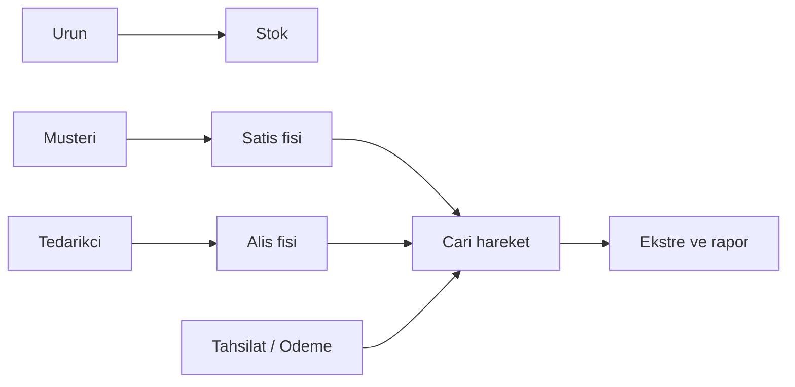
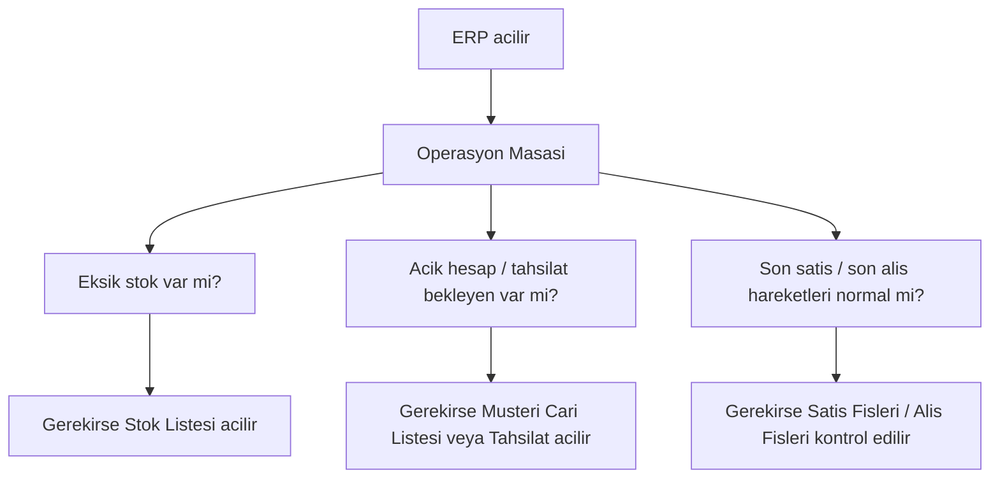
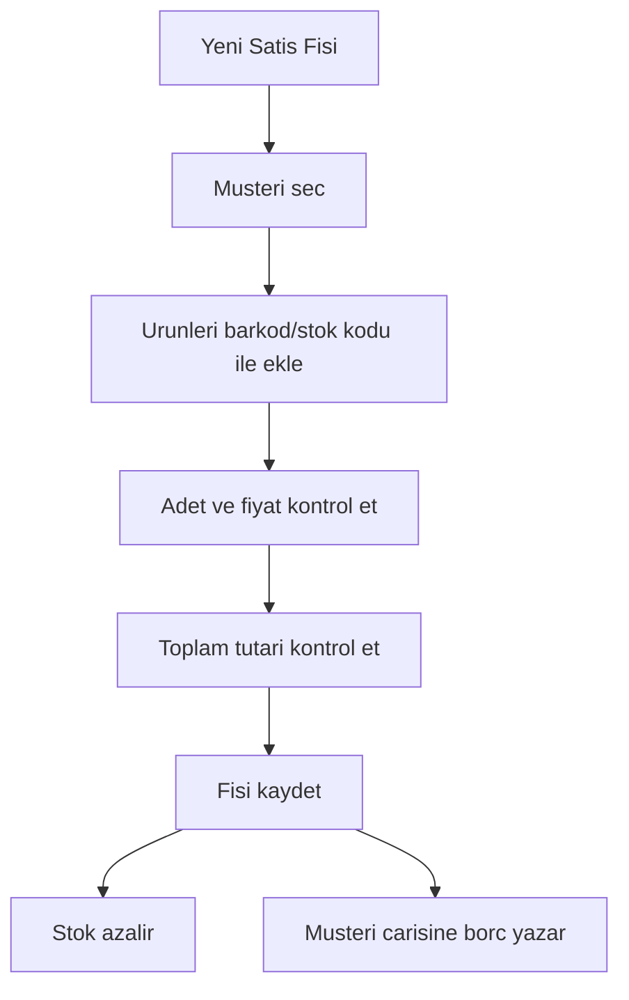
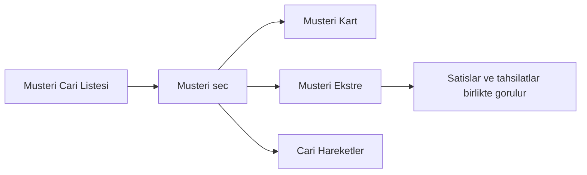
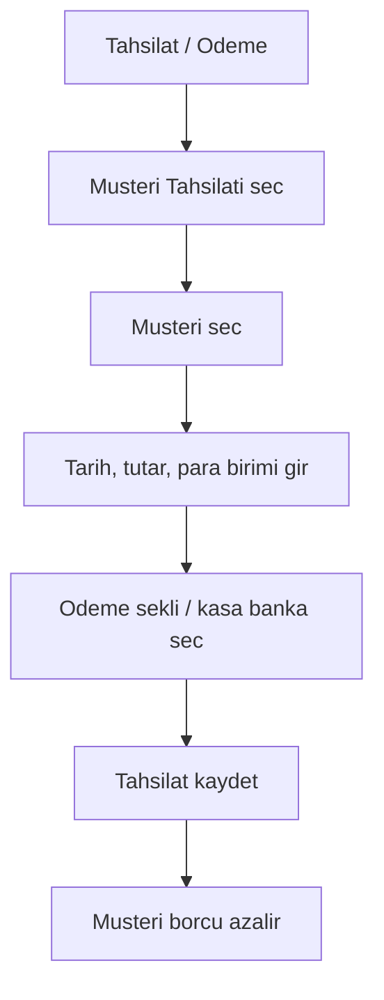
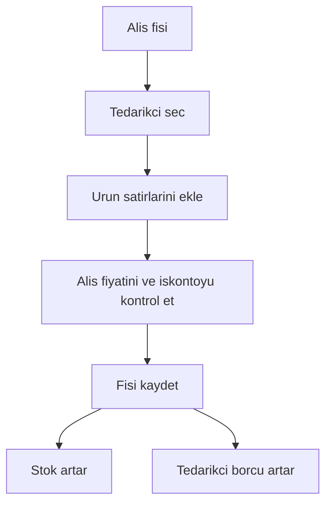
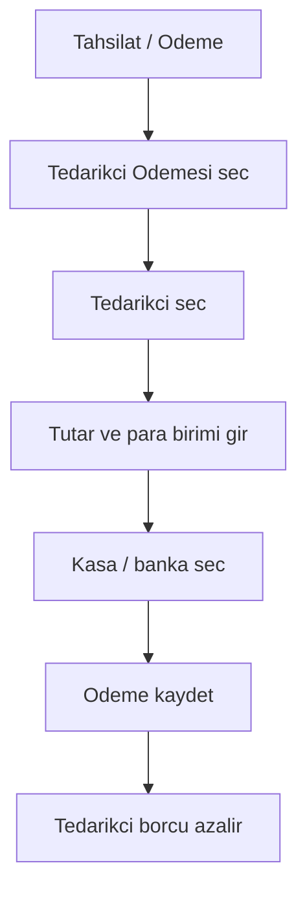
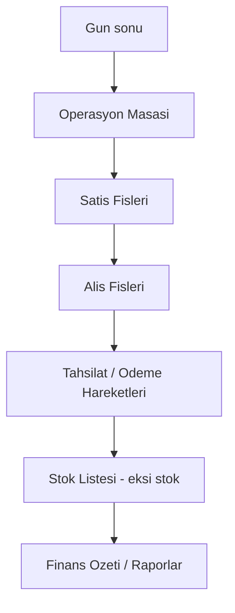

# Melisa ERP V2 - Personel Kullanim Egitimi

Bu dokuman, Melisa ERP'yi ilk kez kullanacak personelin gunluk isi hangi sirayla yapacagini basitce anlatir. Amac her ekrani ezberletmek degil, magazada/ofiste gelen isi dogru ekrana yonlendirmeyi ogretmektir.

## 1. ERP Mantigi

ERP'de her islem bir iz birakir:

Kisa mantik:
- Urun satilinca stok azalir, musterinin carisine borc yazilir.
- Tedarikciden mal alinca stok artar, tedarikci carisine borc yazilir.
- Tahsilat girilince musteri borcu azalir.
- Tedarikci odemesi girilince tedarikci borcu azalir.
- Operasyon Masasi gunluk kontrol ekranidir.

## 2. Gunluk Acilis Kontrolu

Her personel ise baslarken once `Operasyon Masasi` ekranina bakar.

Kontrol sirası:
1. `Eksik Stok Uyarisi`: Eksiye dusen urun var mi?
2. `Acik Hesap Toplam`: Musterilerden tahsil edilmesi gereken tutar var mi?
3. `Son Satislar / Son Alislar`: Bugun girilen fisler dogru mu?
4. `Tahsilat Bekleyenler`: Para alinacak cari var mi?

## 3. Urun Bulma ve Stok Kontrolu

Bir urunun durumunu gormek icin `Stok > Stok Listesi` kullanilir.

Islem sirası:
1. `Stok Listesi` ekranini ac.
2. Hizli arama alanina stok kodu, barkod, urun adi, marka veya kategori yaz.
3. Listeden urunu sec.
4. Sag taraftaki `Urun 360` panelinden satis, alis, stok, tedarikci ve son hareketleri kontrol et.
5. Gerekirse `Urun Karti`, `Hareketler`, `Tedarikci` veya `Cari` butonuyla ilgili detaya gec.

Nelere dikkat edilir:
- Stok miktari eksi ise satis yapmadan once kontrol edilir.
- Satis fiyati ve alis fiyati mantiksiz gorunuyorsa urun karti acilir.
- Tedarikci yanlis ise karttan duzeltilir.

## 4. Yeni Satis Yapma

Musteriye satis kesmek icin `Satis > Yeni Satis Fisi` kullanilir.

Islem sirası:
1. `Yeni Satis Fisi` ekranini ac.
2. Musteriyi sec. Pesin satis ise pesin musteri kullan.
3. Urunu barkod, stok kodu veya urun adi ile bul.
4. Adet, fiyat ve para birimini kontrol et.
5. Fis toplamlarini kontrol et.
6. `Kaydet` ile fis olustur.
7. Sonrasinda fis `Satis Fisleri` ekraninda gorunur.

Kontrol noktasi:
- Kaydetmeden once musteri, urun, adet ve fiyat mutlaka kontrol edilir.
- Fis kaydedilince stok ve cari etkilenir.

## 5. Satis Fisi Kontrolu

Eski satislari gormek icin `Satis > Satis Fisleri` kullanilir.

Islem sirası:
1. `Satis Fisleri` ekranini ac.
2. Tarih, musteri veya belge numarasi ile ara.
3. Fisi sec.
4. Detaydan satirlari, tutari ve cari etkisini kontrol et.
5. Gerekirse ilgili musteri kartina veya cari ekstresine git.

Ne zaman kullanilir:
- Musteri "bana hangi urun kesildi?" diye sorarsa.
- Yanlis kesilen fis kontrol edilecekse.
- Gun sonu satis kontrolu yapilacaksa.

## 6. Musteri Cari Takibi

Musteri borc/alacak durumunu gormek icin `Cari > Musteri Cari Listesi` kullanilir.

Islem sirası:
1. `Musteri Cari Listesi` ekranini ac.
2. Musteri kodu veya unvan ile ara.
3. Bakiyeye gore sirala. Buyuk bakiyeler oncelikli takip edilir.
4. Musteriyi secip `Cari Kart Ac` veya ekstre ekranina gec.
5. Musterinin satis fisleri ve tahsilat hareketlerini kontrol et.

Renk/mantik:
- Borclu musteri: Tahsilat beklenir.
- Alacakli/eksi bakiye: Fazla tahsilat, iade veya ters kayit kontrol edilir.

## 7. Tahsilat Alma

Musteriden para alinca `Finans > Tahsilat / Odeme` ekranindan `Musteri Tahsilati` girilir.

Islem sirası:
1. `Tahsilat / Odeme` ekranini ac.
2. `Musteri Tahsilati` modunu sec.
3. Musteriyi sec.
4. Tarih, tutar, para birimi ve odeme seklini gir.
5. Kasa/banka hesabi sec.
6. Kaydetmeden once sagdaki `Islem Etkisi` paneline bak.
7. `Tahsilat Kaydet` ile islemi tamamla.

Kontrol noktasi:
- Tutar ve para birimi yanlis girilirse cari bakiye yanlis olur.
- Kayit sonrasi musteri ekstresinde tahsilat gorunmelidir.

## 8. Tedarikciden Mal Alis

Tedarikciden gelen mal icin `Alis > Yeni/Toplu Alis` veya `Alis Fisleri` akisi kullanilir.

Islem sirası:
1. Alis fisi ekranini ac.
2. Tedarikciyi sec.
3. Gelen urunleri barkod/stok kodu ile ekle.
4. Adet, alis fiyati, iskonto ve para birimini kontrol et.
5. Fisi kaydet.
6. Kayit sonrasi stok artar ve tedarikci carisine borc yazar.

Kontrol noktasi:
- Tedarikci secilmeden urun satiri eklenmemeli.
- Yanlis alis fiyati maliyeti bozar.
- Fis kaydedildikten sonra tedarikci ekstresinden kontrol edilebilir.

## 9. Tedarikci Cari Takibi

Tedarikci bakiyeleri icin `Cari > Tedarikci Cari Listesi`, detay icin `Tedarikci Ekstre` kullanilir.

Islem sirası:
1. `Tedarikci Cari Listesi` ekranini ac.
2. Tedarikci adina, koduna veya telefona gore ara.
3. Bakiyeye gore sirala. Buyuk borclar oncelikli kontrol edilir.
4. Tedarikciyi secip kartini veya ekstresini ac.
5. Son alis, son odeme, son 1 ay/3 ay hareketlerini kontrol et.

Ne zaman kullanilir:
- Tedarikciye ne kadar borc var?
- Son gelen mal ne zaman girildi?
- Son odeme ne zaman yapildi?
- Hangi alis fislerinden borc olustu?

## 10. Tedarikciye Odeme Yapma

Tedarikciye para odenince `Finans > Tahsilat / Odeme` ekranindan `Tedarikci Odemesi` girilir.

Islem sirası:
1. `Tahsilat / Odeme` ekranini ac.
2. `Tedarikci Odemesi` modunu sec.
3. Tedarikciyi sec.
4. Tarih, tutar, para birimi ve odeme seklini gir.
5. Kasa/banka hesabi sec.
6. `Islem Etkisi` panelinden kayit sonrasi bakiyeyi kontrol et.
7. `Odeme Kaydet` ile islemi tamamla.

## 11. Ekstre Okuma

Ekstre, bir cari hesabinda olan tum hareketlerin defteridir.

Ekstrede gorulecek hareketler:
- Satis fisi
- Alis fisi
- Tahsilat
- Odeme
- Iptal edilen fisler
- Bakiye etkisi

Ekstre kontrol sirası:
1. Cariyi veya tedarikciyi sec.
2. Tarih araligini belirle.
3. Normal ekstre ve iptal fislerini ayri kontrol et.
4. Bakiye ile listedeki hareketlerin uyumlu oldugunu kontrol et.
5. Gerekirse Excel veya PDF cikti al.

## 12. Excel / CSV Aktarim

Toplu veri yuklemek icin `Excel / CSV Aktarim` kullanilir.

Kullanilabilecek aktarimlar:
- Musteri Cari Aktarimi
- Tedarikci Cari Aktarimi
- Stok / urun aktarimi

Islem sirası:
1. Aktarim turunu sec.
2. Dosyayi yukle.
3. On izleme ekraninda kolonlari kontrol et.
4. Kod, unvan, telefon, para birimi gibi alanlari kontrol et.
5. Yanlis dosya ise kesinlikle kaydetme.
6. Dogru ise aktarimi tamamla.

Onemli kural:
- Toplu aktarimdan once yedek alinmali.
- Yanlis tedarikci veya musteri aktarimi cari listelerini bozar.

## 13. Gun Sonu Kontrolu

Gun sonunda sirayla su ekranlar kontrol edilir:

Gun sonu checklist:
- Bugun kesilen satis fisleri dogru mu?
- Bugun girilen alis fisleri dogru mu?
- Tahsilatlar dogru musterilere islenmis mi?
- Tedarikci odemeleri dogru tedarikcilere islenmis mi?
- Eksi stok var mi?
- Acik hesap toplaminda anormal artis var mi?
- Kasa/banka hareketleri beklenen tutarla uyumlu mu?

## 14. Personel Rolleri

Satis personeli:
- Stok arar.
- Yeni satis fisi keser.
- Musteri cari bilgisini gorur.
- Tahsilat bilgisini ilgili yetkiliye bildirir.

Finans personeli:
- Tahsilat girer.
- Tedarikci odemesi girer.
- Cari ekstre kontrol eder.
- Gun sonu kasa/banka kontrolu yapar.

Depo / stok personeli:
- Stok listesini kontrol eder.
- Alis fisindeki urun/adet bilgisini kontrol eder.
- Eksi stok ve fazla stok durumlarini takip eder.

Yonetici:
- Operasyon Masasi ve raporlardan genel durumu izler.
- Acik hesap, stok, satis, alis ve tahsilat risklerini kontrol eder.
- Yetki ve ayarlari yonetir.

## 15. En Sik Yapilan Hatalar

| Hata | Sonuc | Dogru Davranis |
| --- | --- | --- |
| Yanlis musteriye satis fisi kesmek | Cari bakiye yanlis olur | Kaydetmeden once musteri adini kontrol et |
| Yanlis para birimi girmek | Bakiye ve raporlar bozulur | TRY / USD / EUR secimini kontrol et |
| Urunu yanlis adetle girmek | Stok bozulur | Satir adetini kaydetmeden once kontrol et |
| Tedarikciyi yanlis secmek | Borc yanlis tedarikciye yazar | Alis fisi basinda tedarikciyi kontrol et |
| Tahsilati yanlis cariye girmek | Musteri hesaplari karisir | Islem Etkisi paneline bak |
| Toplu aktarimi kontrol etmeden yapmak | Cari/stok listeleri bozulur | On izleme ve yedek olmadan aktarim yapma |

## 16. En Kisa Egitim Senaryosu

Yeni personele su 6 uygulama yaptirilir:

1. `Stok Listesi` ac, bir urun ara, `Urun 360` panelini oku.
2. `Musteri Cari Listesi` ac, bakiyesi yuksek musterileri sirala.
3. Bir musteri ekstresi ac, satis ve tahsilat hareketlerini ayirt et.
4. `Satis Fisleri` ac, bugunku fisleri filtrele.
5. `Tedarikci Cari Listesi` ac, bakiyesi yuksek tedarikcileri sirala.
6. `Tahsilat / Odeme` ekraninda kaydetmeden islem etkisini oku.

Bu 6 adimi anlayan personel ERP'nin gunluk kullanim mantigini kavramis olur.

