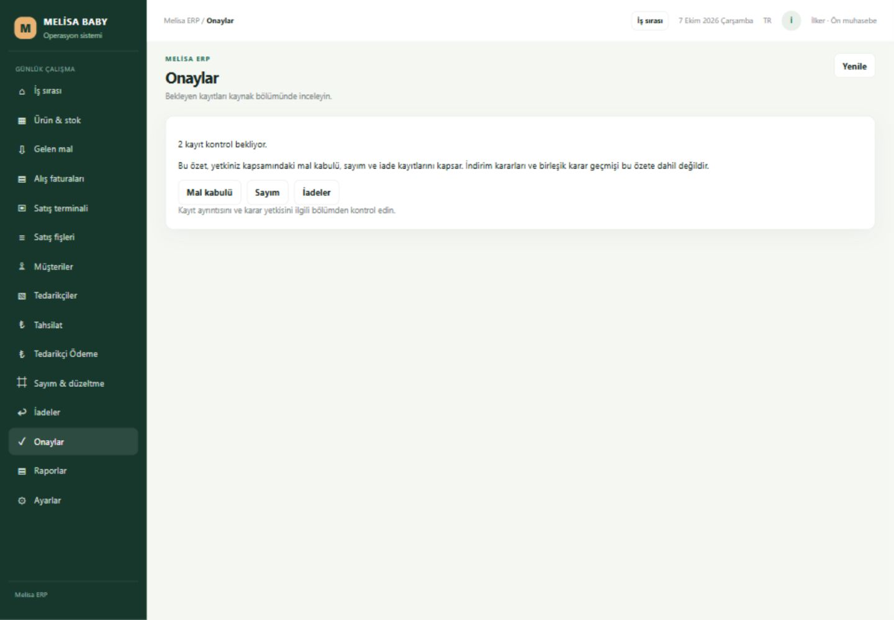

# Goal8 — teknik teslim, insan kabulü bekliyor

7 Ekim 2026. Başlangıç TEST86/source769031c; son çalışan **TEST94/source cee7d7a85b4c797732cfcba8967855f2efbad55b**. Aynı dal `codex/erp-finish-20261004`, [PR23](https://github.com/melihsnyldzz-ui/melisa-erp-v2/pull/23). Son belge commit'i uygulama source commit'inden ayrıdır; doküman teslimi yeni runtime kurulumu değildir.

Finish **49 toplam / 9🟢 / 39🟡 / 1🔴**. D02/D06/E01/E02/E03 teknik kanıtla sarı; D01 güvenli karantinada kırmızı. **İnsan PASS verilmedi; USER_ACCEPTANCE ve ERP-UA24 değiştirilmedi. ERP bugün LIVE'a geçiş için kabul edilmiş değildir.**

## Paket ve veri sınırı

[Runtime makbuzu](runtime-proof.json): 1468 dosya manifesti, 5194 web / 4144 API / 4146 salt okunur native, sahipli süreçler ve sağlık, Limited/Interactive başlangıç görevi/config eşleşmesi doğrulandı. DB `Semih\MELISADEV / MELISA_ERP_SIRKET_TEST_20260929_01`; LIVE erişimi0, sysadmin0. C: yaklaşık196,8GiB boş. Eski paketler korunur.

Normal katalog/cari okumaları gerçek aktarılmış kaynaktır; tarihsel30Eylül açılış ve onaylı ara deltalar güncel Vega ile aynı ilan edilmez. Normal işlem adapterleri ayrılmış sentetik TEST kapsamındadır. Gerçek ticari seçicilerin LIVE kullanım kabulü ayrıca gerekir; mevcut genel API'nin varlığı bunu kapatmaz. Yeni gerçek cari/finans aktarımı, Vega/LIVE yazması, gerçek T1, müşteri gönderimi, main merge yok.

## D01 / D02 / D06

[Hazırlık denetimi](readiness-audit.md): held54ürün kaynakları korunur, yeni işlemlere/fiyat-medya kararına alınmaz. Güvenli dışlanan54kart CANLIDAN SONRA; kullanılmadıkları varsayılmaz. D02 200cari/209hesap (205kimlik kanıtı/4yeni kart planı), rol/döviz/B-A ayrı, LL/UNKNOWN held. Dört tedarikçi oluşturulmadı; finansal hazır kapsam ile kimlik kanıtı aynı şey değildir. Goal7.3 16hesap/15delta+1no-op/replay0 korunur ve tekrar uygulanmadı; sonraki Vega drift hata sayılmaz.

[Final prosedür](../../../erp-v2/canonical-20261007/final-cutover-procedure.md), [writer makbuzu](cutover-native-proof.json), [cari okuyucu](cutover-party-reader-proof.json), [tam stok/fiyat okuyucu](cutover-full-reader-proof.json): collector→sealed plan→writer→replay0→mutabakat→inverse/parent recovery ayrılmış native SQL'de kanıtlı. Müşteri/tedarikçi TRY/USD/EUR ve B/A ayrı; yerel hareket ve önceki committed delta korunur. Tam okuyucu16671ürün/63775typedfiyat üzerinde forward/inverse doğrulandı; NULL, hold, drift/CAS negatifleri korunur. **Gerçek final kaynak henüz toplanmadı; çalışan normal API/browser/CRM FINAL bağlamına geçirilmedi.** Final gün güncel scope/yedek/onay ve gerçek aktivasyon kabulü gerekir.

## E01 / E02 / E03

[Bağlı gün](day-proof.json) dokuz aşamalı native sentetik prova: kabul4→alış25095→satış34621→tahsilat47760→CRM native taslak10→ödeme58087→sayım47→iade225→rapor. Her stok/finans kenarı ayrı native okuma ve replay0 ile doğrulandı. Stok başlangıç/son3; müşteri100→100TRY; tedarikçi -100→-80TRY; kasa300→360TRY. Alış160–ödeme60–iade80=20TRY fatura kalanıdır; tedarikçi net -80TRY ile karıştırılmaz. Eski100TRY alacak korunur. CRM katalog ürünü30740 ile mal kabul ürünü325503 farklı ve kanıtlıdır. Bu gün TEST90→TEST92 continuation mühürüyle çalıştırıldı; son UI paket94 bu kayıtları yalnız geri okudu, gün ikinci kez uygulanmadı.

[Rol/rapor](roles-proof.json): mevcut aktörlerde13/13 olumlu-yetkisiz kontrol, yedi native rapor7/7. [Ekran makbuzu](ui-proof.json): 15ekran×1440/1024/390=45; kök sayfa taşması, bitmeyen yükleme veya genel hata yok. 390px sayım47 modalı görünür/kapandı; Tahsilat offline→yenileme aynı fişi ve hareketleri geri okudu, yeni POST yapılmadı. Her modüle fiziksel ağ kesintisi uygulanmış gibi genellenmez. Native gün ve hedefli controller/replay/error testleri uygun modülleri tamamlar. İnsan/fiziksel cihaz kabulü bekler.

Dar son düzeltmeler: gerçek iki ürünlü scope DTO'sunun frontend kabulü (scope/role sınırı korunarak), tahsilat fiş listesinin yeniden çizimde kaybolmaması ve seçili fişin işlem tarihi, eski DONE satış fişinin503 hatasının geçerli güncel satış kapsamını gizlememesi. Belirsiz pending journal fail-closed kaldı; journal silinmedi, otomatik POST yok. 36hedefli DTO/controller testi geçti; önceki107profile/runner sözleşme testi ve exact source CI kullanıldı. Tasarım korunur.

## ERP ↔ CRM / terminal / işletim

[CRM kanıtı](crm-connected-proof.json) aynı müşterinin atanmış konuşması, çeviri, CONFIRMEDfotoğraf/typedfiyat ve native taslak10/replay/readback'i kapsar; stock/finance etkisi0. Yeni gerçek mesaj yok; provider/assignment/rol/CRM source değişmedi. Son CRM GET medyan150ms; mevcut konuşma normal tarayıcıda geri okundu. Personel insan kabulü ve gerçek FINAL aktivasyonu ayrı bekler.

Terminal mevcut satış rolüyle tarayıcıda gerçek katalog/baştaki sıfır/ayrı döviz okuması korundu; yeni fiziksel Zebra kanıtı yok. Wi-Fi, trigger, Enter suffix, kamera, uyku/uyanma, login, vardiya tek fiziksel listede bekler. Goal6 ONLINE/READ_ONLY ayrı restore/35tablo/177guard tarihsel kanıtı ve Goal7.3 VERIFYONLY makbuzu korunur; ikincisi restore sayılmaz. Son startup görev/config/hash/health salt okunur doğrulandı; gerçek reboot/logon ve güncel LIVE kurtarma kabulü yapılmadı. Yeni uzun restore açılmadı.

## Hız

[Ölçüm makbuzu](performance-proof.json); GET medyanlarıms, tarayıcı açılış süresi değildir. Küçük farklar için yeniden yazım yapılmadı. İlk50vebarkod başlangıç86'ya göre iyileşti; müşteri/tedarikçi/iade/ödeme artışı görünür kaydedilir, birkaç saniyelik liste regresyonu yok.

| API | TEST86 | TEST94 |
| --- | ---: | ---: |
| home | 34 | 23 |
| catalog | 974 | 726 |
| next50 | — | 761 |
| code | — | 687 |
| card | — | 217 |
| barcode | 662 | 433 |
| customers | 421 | 514 |
| suppliers | 475 | 447 |
| sales | 41 | 39 |
| receiving | 286 | 252 |
| purchases | 162 | 243 |
| collection | 165 | 238 |
| count | 58 | 85 |
| returns | 444 | 658 |
| payments | 475 | 706 |
| CRM konuşma | — | 150 |

## İnsan kabulü ve durma

[Tek15–20dk/sekiz kontrol](acceptance.md) ve [LIVE blocker tablosu](live-blockers.md). Teknik hazır sonucu insan PASS veya LIVE-ready iddiası değildir. D02 kullanılacak cari kanıtı, gerçek ticari operasyon kapsamı, gerçekT1/FINAL aktivasyon/kurtarma ve insan/fiziksel kabul somut kalanlardır. **Goal8 tesliminden sonra DUR; yeni goal/migration/finalT1/LIVE kendiliğinden başlatılmaz.**
