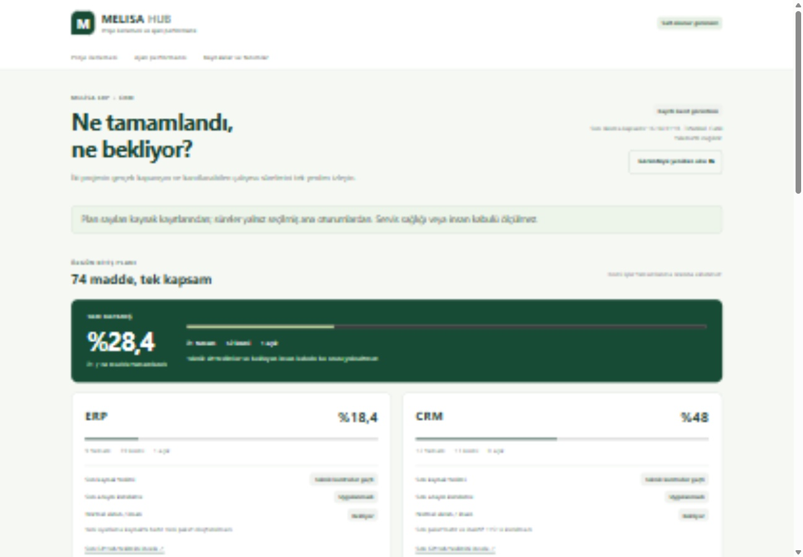
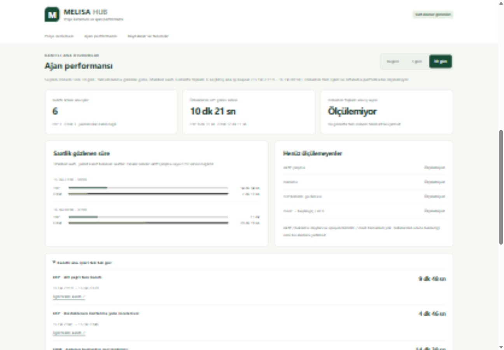
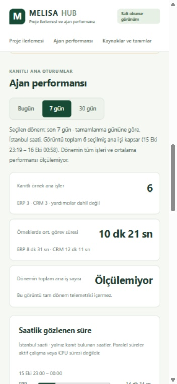

# Melisa Hub — proje ilerlemesi ve ajan performansı MVP

16 Ekim 2026. Mevcut Hub tasarımında bağımsız, salt okunur bir yönetici görünümü. Özgün ERP/CRM kapsamı 74 maddedir; bu ekran yeni bitiş maddesi, görev takip sistemi veya zamanlayıcı oluşturmaz. Mevcut ortak TEST’e kurulmadı; kendi izole localhost önizlemesinde gerçekten çalıştırıldı.

## Çalıştırma ve çalışan adres

Node.js ile depo kökünde `node scripts/hub-progress-server.mjs` çalıştırılır. Adres: [yerel Hub paneli](http://127.0.0.1:5294/melisa-hub/progress/). Sunucu yalnız 127.0.0.1:5294’e bağlanır; port doluysa başka süreci durdurmaz. Yalnız açıkça listelenen panel dosyaları sunulur. GET/HEAD dışı yöntem405, yabancıHost421, bozuk istek400 ve diğer dosya/API yolları404. CSP/self, nosniff, no-store ve no-referrer kullanılır. ERP/CRM API proxy, ortam/config okuma, sağlık probu, kimlik bilgisi veya veritabanı bağlantısı yoktur.

Normal Hub’ın mevcut gezinme ve güvenlik kodu değişmedi; yalnız `/melisa-hub/progress/` menü bağlantısı eklendi. Bu link ayrı yerel panel rotasıdır, mevcut safeInternalUrl istisnası değildir. Önizleme eski Hub ana sayfasını veya onun servis kontrollerini çalıştırmaz. Otomatik Windows başlama / ortak runtime kurulumu bu teslim değildir.

## İlerleme ve veri kapsamı

| Alan | Tamam | Kısmi | Açık | Toplam | Tam kapanış |
| --- | --- | --- | --- | --- | --- |
| ERP | 9 | 39 | 1 | 49 | %18,4 |
| CRM | 12 | 13 | 0 | 25 | %48 |
| Birleşik | 21 | 52 | 1 | 74 | %28,4 |

Kaynaklar sabit [ERP bitiş planı](https://github.com/melihsnyldzz-ui/melisa-erp-v2/blob/a26e06fe8a70003b613bdf9ca73d54bada5e29d0/ERP_FINISH_PLAN.md) ve [CRM bitiş planı](https://github.com/melihsnyldzz-ui/melisa-crm/blob/60a82d00bab12888291033e271b4a4c019427ec6/CRM_FINISH_PLAN.md). Kısmi maddelere keyfi puan verilmez. Son kaynak teslimi, adayın gerçekten kurulması, normal ekran ve insan kabulü ayrı gösterilir. Önceki servis gözetimi/kurtarma engeli kapanmış veya runtime sağlıklı ilan edilmez. Gerçek insan, cihaz ve reboot kabulü bekler.

Paneldeki `evidence.json` mevcut kayıtların minimal türetilmiş görüntüsüdür; yeni operasyon günlüğü değildir. Altı tamamlanmış ana oturumun başlangıç/bitiş özetleri desteklenen native okuyucudan doğrulandı. Ham task/thread/callback kimliği, özel devir metni, korumalı konfigürasyon, ticari bilgi ve log tutulmaz. Her gözlem semantik ad ve mevcut kamuya açık teslim bağlantısıyla açıklanır. Git commit tarihinden görev süresi türetilmedi. Görüntünün kanıt zamanı ekranda görünür; Yenile yalnız yerel dosyayı tekrar okur, yeni GitHub/API sorgusu veya scheduler oluşturmaz.

## Ölçüm tanımları

- Tam kapanış: tamamlanan / özgün toplam. Teknik test insan kabulü değildir.
- Ana iş süresi: doğrulanmış ana oturum başlangıcı → tamamlanma; saniye hassasiyetinde duvar saati. CPU veya aktif çalışma süresi değildir. Yardımcı/reviewer turu sayılmaz. Aynı anahtar ve aynı güvenli içerik alias’ı tekilleştirilir; çelişen anahtar dışlanır.
- Bugün / 7 gün / 30 gün: Europe/Istanbul tamamlanma gününe göre. Gece yarısını geçen işin bütün duvar süresi örnek ortalamaya katılır; saatlik grafikte seçilen pencereyle kesişen bölüm gösterilir. Paralel ERP/CRM süreleri ayrı tutulur.
- Bugün: gözlenen4iş (ERP1/CRM3), örnek ortalaması11dk53sn.7/30gün: yalnız eldeki6iş (ERP3/CRM3), örnek ortalaması10dk21sn. Bunlar bütün dönem veya bütün hesap performansı değildir. Tüm dönem iş sayısı ve ortalama performansı ölçülemez; panel bunu açıkça söyler.
- Aktif/bekleme: gerçek durum olayları yoksa null. Dot bildirimi: mainDONE → doğrulanmış bildirimin gelişi. Devir: doğrulanmış devir başlangıcı → mainstart/ACK. Eşleşen olaylar yok; tamamı null/ölçülemiyor. Kullanıcı beklemesi bunlara katılmaz.
- Altı saatten eski görüntü eski, ileri zaman veya AUTH/RATE_LIMIT/UNAVAILABLE kaynak hatası unknown olarak gösterilir. Boş kanıt0iş/0süre sayılmaz. Bozuk dosyada panel değerleri gizlenir. Otomatik canlı kaynak yenilemesi bu MVP’de yoktur.

## Teknik ve gerçek ekran kanıtı

- 19 hedefli test: model/aritmetik, null/coverage, aynı ve alias duplicate, çelişki, yardımcı/eksik/reversed/future olay, İstanbul günü/gece yarısı,7/30gün, saat bölme, süre formatı, URL/XSS ve sunucu istek ayrıştırma. Mevcut offline guard altında19PASS/0FAIL/0skip. İki inceleme P2’si önce hedefliFAIL olarak üretildi; request-target400 ve alias tekilleştirmesiyle kapatıldı. Bağımsız mevcut reviewer final açıkP1/P2=0.
- Yalnız yeni localhost sunucusunda13HTTP smoke geçti; yanlışHost/yöntem/bozukURL/API/dosya kapsamı güvenlik yanıtları doğrulandı. Ortak ERP/CRM’ye istek yapılmadı.
- Gerçek tarayıcıda Bugün4/7gün6/30gün6, klavye ve normal fare filtresi, yeniden okuma, boş kanıt, kaynakAUTHhatası, bozuk kaynakta gizleme ve XSS başlığının düz metin kalması doğrulandı. Sentetik görüntülerden sonra orijinal evidence byte’ları aynı hash ile geri kondu. Console error/warning0.
- Masaüstü1440×1000CSS ve mobil390×844CSS’de yatay taşma0. Geçici emülasyon/viewport ayarları kaldırıldı, yeni panel kullanıcıya açık bırakıldı. Responsive kontrol fiziksel telefon kabulü değildir. Ekran yakalama yalnız bu yeni panelde yapıldı; sır, kişi/iletişim, başka sekme veya özel operasyon kimliği görünmedi.
- Yerel TEST kurulum/başlatma yalnız bu yeni statik önizlemedir. Eski ERP/CRM servisleri, SQL/config/roller/credential/journal/private paketler okunmadı veya değiştirilmedi. Yeni ticari/finansal işlem, LIVE/Vega/T1, mesaj, ücretli çağrı ve main merge yoktur. Önceki kabuller,49+25 yaprak ve insan kabulü aynı kalır.

Makine tarafından okunabilir [güvenli doğrulama kaydı](verification.json). Exact kaynak commit/CI ve son belge HEAD’i teslimde ayrı kaydedilir; eski CI yeni HEAD’e atanmaz. UI kanıtı gerçek personel kabulü veya genel CRM06 kapanışı değildir.

## Ekranlar

## Exact kaynak CI ve çalışan dosya bağı

Kaynak [1f3b6ade4c74ee4cd9a4287a73275f46db3bb7a1](https://github.com/melihsnyldzz-ui/melisa-erp-v2/commit/1f3b6ade4c74ee4cd9a4287a73275f46db3bb7a1) için [PR CI38817934818](https://github.com/melihsnyldzz-ui/melisa-erp-v2/actions/runs/38817934818) ve [push CI38817903024](https://github.com/melihsnyldzz-ui/melisa-erp-v2/actions/runs/38817903024) completed/SUCCESS; iki çalışmanın da quality-build-test, windows-startup-test ve secret-scan job’ları başarılı. Yeni19hedef testin adları PR quality logunda bağımsız geri okundu; yalnız yerel PASS’e dayanılmadı. Çalışan5294önizlemesinden beş yeni asset okunup kaynak commit ve çalışma dosyalarıyla eşleştirildi. Sonraki yalnız doküman HEAD’i [skip ci] ve bu kaynak CI’den ayrı tutulur. Main merge/ortak runtime kurulumu yapılmaz.

## Normal Hub ve stable edge rota düzeltmesi

[Otomatik review P2](https://github.com/melihsnyldzz-ui/melisa-erp-v2/pull/31#discussion_r4288969705) doğrulandı: ilk panel kendi localhost sunucusunda çalışsa da mevcut Hub middleware/stable-edge allowlistleri yeni iç yolları404/403 ile reddediyordu. Kaynak [4aecffeb93fbd6f69eecf1505d56729537d9ce88](https://github.com/melihsnyldzz-ui/melisa-erp-v2/commit/4aecffeb93fbd6f69eecf1505d56729537d9ce88) iki mevcut katmana yalnız panel dizin girişi ve beş exact dosya için GET/HEAD desteği ekler. Yeni progress alt dizininin symlink/junction olması da reddedilir. Genel dosya/static wildcard, auth/origin/forwarding/tailnet/rol/CSP/scope veya servis davranışı değişmedi; statik istekler status/health probu tetiklemez.

Yedi yeni offline fixture önce3FAIL/4PASS, sonra7PASS/0skip; yalnız doğrudan etkilenen üç eski static/private/traversal regresyonu3PASS. Bağımsız inceleme açıkP1/P2=0. Yeni exactsource [PR CI38819159354](https://github.com/melihsnyldzz-ui/melisa-erp-v2/actions/runs/38819159354) ve [push CI38819153134](https://github.com/melihsnyldzz-ui/melisa-erp-v2/actions/runs/38819153134) completed/SUCCESS, her birinde üçjobbaşarılı; yedi yeni routing testi PR qualitylogunda geri okundu. Eski1f3CI bu yeni kaynağa atanmadı; önceki CI nesnesi tarihsel olarak korundu.

Beş sunulan panel dosyası yeni4aecsource ile yeniden eşleştirildi; UI/server dosyaları önceki kaynakla byte aynı. Bu nedenle mevcut1440/390 tarayıcı,13localhost HTTP smoke,19model/UI test ve üç screenshot kanıtı açıkça REUSE edildi; yeni GUI turu yapılmış gibi tarih güncellenmedi. Bu düzeltme **ortak Hub/stable runtime'a kurulmadı**; yalnız kaynak/offline route kanıtıdır. Mevcut5294izole panel çalışır, ortak servis/config/SQL/kimlik/veri yazısı veya restart yoktur. İnsan kabulü ve özgün74sayaç aynıdır. Sonraki yalnız doküman HEAD’i [skip ci] ve kaynak CI ayrı tutulur.
