# 22 Ekim — Güncel temiz TEST: normal mal kabul → alış → tek borç

Yalnız yapay mağaza günü kapsamında2.2 ve2.3 normal hesaplarla çalıştı.2.4önceki satış kanıtı yeniden kullanıldı; yeni satış/CRM siparişi oluşturulmadı. İnsan kabulü BEKLİYOR; sonraki2.5tahsilat/ödeme/kasa bu teslimde açık.

| Alan | Son doğrulanmış sonuç |
|---|---|
| ERP uygulama/paket | `5aa4cb3eb143ec1171f0b221e16919d36893883d` / `CLEAN-ERP-20261022-5aa4cb3eb143`, PR54 |
| Frontend |7dc6fac build;5aa ile frontend farkı0; HTTP/dist eşit |
| CRM |c8d0e28source/frontend korunur; yeni native5aa exactsource/paket pini, PR3. PaketID alanı uygulamada yok; uydurulmadı.|
| Hedef |Semih\MELISADEV; yalnız MELISA_ERP_CLEAN_TEST_20261022/envE662FD94-D797-4B3B-938A-D143AD758B67;loopback4194/4196/5244/62800–3;T1false/externalfalse|
| Normal GUI |Depo18count3→submitreceipt3→sorumlu19approve→invoice4draft/finalize; yenile aynı kayıt.|
| Stok/cari |21→23ADET yalnız kabulde; alış kesinleşmesi120TRYtedarikçi borcu; stok23kalır. Önceki müşteri376,50TRY/sale1 korunur.|
| Normal ürün/CRM |0007 MELISA/barkod0000000000007/fotoğraf/23ADET/125,50TRY;0161USD8,55/0205EUR10,25 korunur. CRMatanmış örnek müşteri veorder3/sale1FINALIZEDgüncelGETileokunur.|
| Tekrar/rol |9HTTP kontrolü; aynıUUID/bodyreplay200,aynıUUIDfarklıbody409,personelapprove/purchase403,sıfır400,barkodçatışma409,yanlışdöviz400;native4196POST403. İkinci ticari etki0.|
| Native tanımlar |8originaldraft+12tarihselSALE+2compatibility+23activehash/enableddoğrulandı; guardkapatılmadı.|
| Prova/geri dönüş |Gerçeknative10adım ve eskiSALEnewguardregresyonu dıştransactionrollback ile önce=sonra; COPY_ONLY/CHECKSUM+VERIFYONLY. Gerçekrestore yok; boşcohort inversesi commit sonrası ticari ters kayıt diye sunulmaz.|
| Koruma |Eski16listener birebir aynı.12scope11SHAaynı;old_usersnormalgirişlast_login_atfarkı ayrı. Eskirol/izinler aynı;uygulamadausersUPDATEyalnızlast_login_at. TEST125/DB02/yedekler/Vega/LIVE değişmedi.|
| CI |5aa exact [PR](https://github.com/melihsnyldzz-ui/melisa-erp-v2/actions/runs/39804466004)/[push](https://github.com/melihsnyldzz-ui/melisa-erp-v2/actions/runs/39804453903) SUCCESS/6job. BelgeHEAD ayrı.|
| Makbuz |Private runtime/installation-receipt-store-day.json;SHA256 `5f804901b42bf40d0970cf39e962df6768616939ca28500d7d3e21ab59523c19`.|

İlk actualnative hata dosyaları korunur: eksikdepo kolonları/sourceenum nativealtermigrationuyumuyla düzeltildi; beşeski source enumdeğeri korundu,WITHCHECK trusted kaldı. Native120TRY stock_cost_effect_try bir bedel snapshot'ıdır; ikinci fizikselstokhareketi değildir. UI'de eskiFX adapterinin bucleankapsamda gereksizmount'u ve kayıtlıkurGETprojeksiyonu düzeltildi. Mevcut invoiceDraftService hesaplama/motoru kullanılır; yeni ticari motor yok.94ilgili kontrol/build ve55okuyucu kontrolü örtüşür, toplam sayıya eklenmez. Son kaynakRO açıkP1/P2=0. 8journal=5GUIişlemi+3etkisiz farklıUUIDfinalize tanığı;8ticari işlem diye sayılmaz.

[Mal kabul](http://127.0.0.1:5244/ornek-akis.html#goods) · [Alış](http://127.0.0.1:5244/ornek-akis.html#purchases) · [Stok](http://127.0.0.1:5244/ornek-akis.html#stock) · [CRM](http://127.0.0.1:62800/).

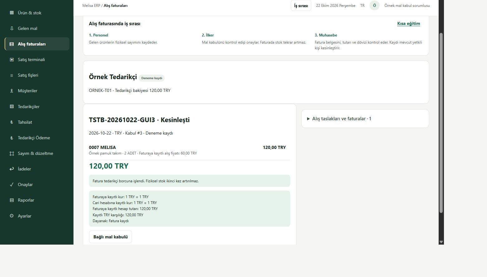
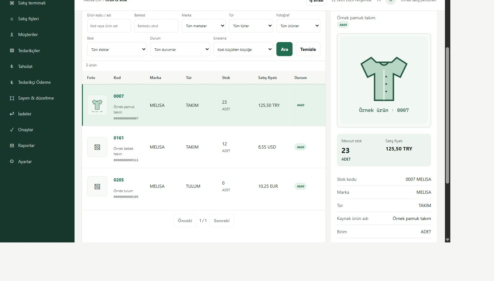

---

## Tarihsel iş1 kurulum: CRM siparişi → normal ERP onayı → tek native satış

ERP-DEC-070'in dar bağlantısı gerçek temiz yapay SQL hedefinde tamamlandı. Bu sonuç bütün mağaza günü, eski Shared/P03 kurtarması, launcher veya gerçek işletme/insan kabulü değildir. Önceki kayıtlar aşağıda tarihli olarak korunur.

**Sonraki aynı iş2 / mağaza günü:**2.1aynı product1/customer1/supplier1 ve başlangıç–mevcut etkileri salt okunur eşlendi (24→21stok,0→376,50TRYmüşteri,0tedarikçi).2.2henüz açık: mal kabul/depo/ayrılmış rol ve native alış adapteri mevcut temiz hedefe bağlı değil. Mevcut stage4 örüntüsünden yalnız3satış guardı için exact-before/after ve eski gövdeyi koruyan offline derleyici, native bind/finish/sameTX receipt kanıtı gerektiren ayrı işlem kapsamı kaynakta hazırlanıyor; kurulum yapılmadı.16hedefli kaynak testinin fake driver sonucu gerçek mal kabul/alış kabulü değildir. Gerçek temiz SQL'de eksik bind prosedürü2812ret verdi; kapsam/callback açılmadı, kısa transaction geri alındı; stok21/müşteri376,50/tedarikçi0/sale1/purchase0/stockmovement1/intent0 öncesi=sonrası. Placeholder19 negatif girdidir, yeni kullanıcı/rol oluşturulmadı. Private `store-day-missing-cohort-proof.json`.2.3iş1kanıtını yeniden kullanacak;2.4tahsilat/ödeme,2.5sayım/iade/iptal,2.6gün sonumutabakatı sıradadır. Yeni Goal/plan/TEST/ajan yok; özgün insan kabulleri/sayaçlar aynı. Aşağıdaki kurulu3db/c8 tablosu iş1'in doğrulanmış sonucudur, yeni kaynak parçasının kurulduğu iddiası değildir.

İş1 için CRM bağımsız kaynak/makbuz/görsel/nihai belge RO eşlemesi de kapandı, açıkP1/P2=0. CRM belge teslimi `5342b4358d8cd7e0ffb606a93fa532e3049e6f55` PR3'tedir; bu docs-only/skipci teslimi c8uygulama/kurulumCI'si değildir. Aynı f923makbuz ve gerçek ekran kanıtı korundu.

| Alan | Doğrulanmış sonuç |
|---|---|
| ERP uygulama source / paket | `3db0830df16d36d59cc69b1a19feb593357aaf35` / `CLEAN-ERP-20261022-3db0830df16d`, PR54 |
| ERP frontend |9f541f98 build; sonraki3db uygulama frontend farkı0; sunulan index gerçek dist ile eşit |
| CRM source / frontend | `c8d0e28f0ea6cf16133c87dd548a4281381abfb7`, PR3; gerçek temiz build yapıldı, sunulan index eşit. Ayrı runtime package-health alanı yok; kaynak/PID/dist kanıtı kullanıldı |
| Hedef | `Semih\MELISADEV / MELISA_ERP_CLEAN_TEST_20261022`, environment `e662fd94-d797-4b3b-938a-d143ad758b67`, synthetic=true / actualT1=false / externalOperations=false |
| Normal personel15 |Mevcut sipariş3,3×125,50TRY; `CRS-20261022-3` fatura1 DRAFT. Stok24/müşteri0; onay düğmesi yok, sorumlu onayı gerekiyor |
| Normal sorumlu17 |Ayrı normal parola formuyla giriş; onay POST200. Aynı fatura1 FINALIZED; stok24→21, müşteri0→376,50TRY |
| CRM normal atanmış personel |Mevcut45064956-9c91-470f-a7b6-a9330b60e456 kayıt ve bağlı satış FINALIZED/CRS-20261022-3/376,50TRY. Yenileme GET200 + `/sale` GET200; yeni taslak/satış POST0 |
| Bağımsız SQL/API |3eskiorder/1invoice/2action/0intent; tek quantity_out3 stok hareketi ve tek376,50TRY müşteri hareketi. Normal ürün API stoğu21, normal müşteri API bakiyesi376,5 |
| Tekrar güvenliği |Aynı finalUUID/body iki eşzamanlı çağrı200/replayed; farklıUUID/aynısipariş200/replayed; aynıUUID/farklıbody409; ikinci fatura/stok/cari etkisi0. Aynı siparişi yeniden taslağa aktarma da replay |
| Yetki sınırı |Personel finalize403; native4196 salePOST403; satış yazması yalnız ERP4194. Native4196 purpose draft-only, stock/ledger capabilityfalse kalır |
| Gerçek rollback |Mevcut native finalize motoru tamamlandıktan sonra kontrollü hata verildi; dış transaction stok24/cari0/DRAFT/action1/intent0 durumuna döndü. Bu prova normal GUI onayından önce yapıldı; geçmişi silen restore/ters kayıt yapılmadı |
| Kaynak koruması |Özgün sipariş başlık/satır/receipt, fiyat, medya/original medya ve eski20/21izinlerinin7before-image SHA'sı birebir eşit.8native+12eski satış+2companion tanım/hash geçerli |
| Eski kurulu sistem |16listener adres/port/PID/doğum/executable birebir eşit; TEST125/DB02/eski ticari veriler/yedekler korunur |
| Yedek |Yeni cleanDB COPY_ONLY/CHECKSUM backup ve RESTORE VERIFYONLY geçerli. SQLExpress COMPRESSION ilk ret kaydı korunur; desteklenen sıkıştırmasız yol kullanıldı. Gerçek restore yapılmadı |

Normal GUI ilk dönüşümünde kaynak sözleşmesinin barkodu NULL bırakması güvenli409ret üretti; fatura/stok/cari etkisi oluşmadı. Mevcut kesin ERP kimliği/kod/ad/fiyat/birim/stok/karantina kontrolü korunarak NULL aynen invoice'a aktarıldı; primary barkoddan tahmin yapılmadı. Eski12immutable tanım değiştirilmeden `begin_v2`+ikiimmutablehash companion eklendi; gerçek olumlu begin/prova rollback'i ve gerçek normal create/finalize ile doğrulandı. Verilmiş barkod için exact eşlik şartı kaynakta korunur. Eski v1barcodedrift ret provası NULLpozitifini kanıtlamadığı için yeni barcode kabulü sayılmadı.

İkinci dar düzeltme: DBkimlik/bağımlılık/transaction başlangıcı da typed503 hata sınırında; SQL ayrıntısı normal ekrana çıkmaz.8hedefli test PASS; mevcut bağımsız kaynak incelemesinde açıkP1/P2=0. İlk GUI retleri ve tüm başarısız prova logları private alanda tutuldu. Yeni17sentetik sorumlunun Türkçe adının SQLdosya kodlaması düzeltildi; rol veya parola değiştirilmedi.

Normal ERP listesinde özgün immutable CRM siparişi `Taslak` kalır; ayrıntıda ayrı bağlı satışın tamamlandığı gösterilir. CRM de “sipariş oluşturulurken etki yoktu” ile “bağlı satış şimdi tamamlandı” bilgisini ayrı gösterir. Tahsilat, ödeme veya rezervasyon oluşturulmadı. Bilinmeyen maliyet snapshot'ları NULL kaldı; ürün maliyet/alış fiyatı yeniden hesaplanmadı.

ERP3db exact [PR CI](https://github.com/melihsnyldzz-ui/melisa-erp-v2/actions/runs/39783687016) / [push CI](https://github.com/melihsnyldzz-ui/melisa-erp-v2/actions/runs/39783679870) SUCCESS. CRMc8 exact [PR CI](https://github.com/melihsnyldzz-ui/melisa-crm/actions/runs/39779665785) / [push CI](https://github.com/melihsnyldzz-ui/melisa-crm/actions/runs/39779654667) / [offline AI](https://github.com/melihsnyldzz-ui/melisa-crm/actions/runs/39779665786) SUCCESS. Son belge teslimi çalışan source/paketinden ayrıdır.

Private makbuz: `C:\Sirket\ERP\clean\20261022\runtime\installation-receipt-order-sale.json`, SHA256 `f9231d810a7140f2816ca0ec3edea99be3ccbbe3a675e5b5cc335742f2e19c82`. Bağlı kanıtlar: `order-sale-native-rollback.json`, `order-sale-replay-api.json`, `order-sale-independent-final.json`, `order-sale-crm-readback.json`, `order-sale-approval-events.json`, `order-sale-customer-api.json`, companion prova/kurulum logları. Ham private makbuz, sırlar ve ticari arşiv GitHub'a alınmaz; aşağıdaki ekranlar yalnız yapay kayıtlardır.

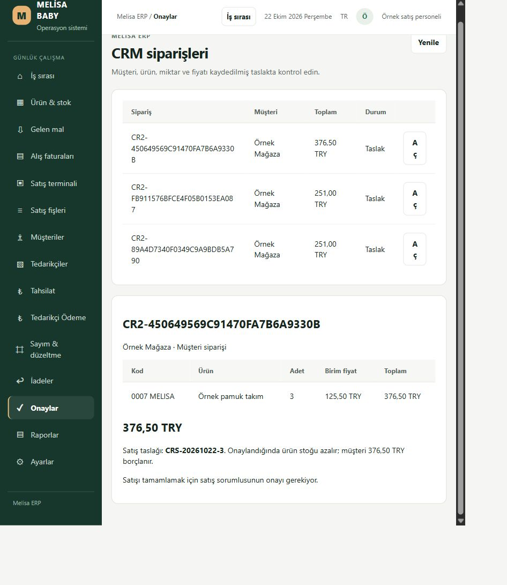

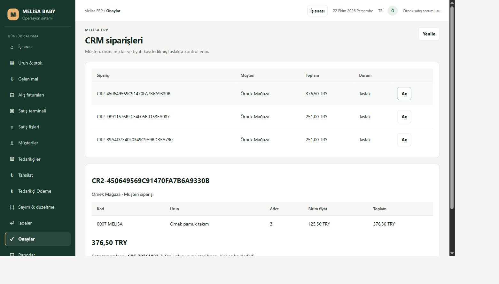

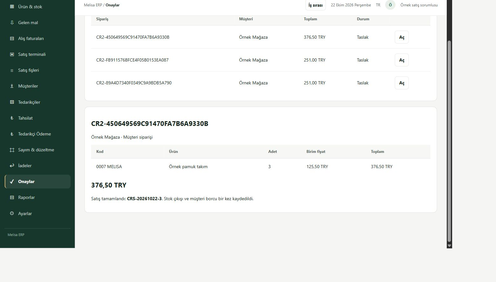

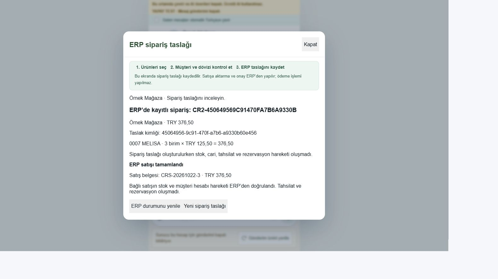

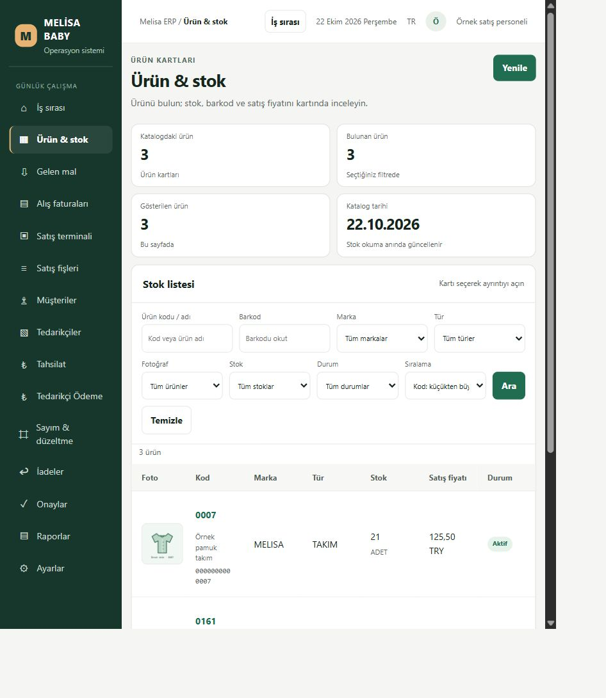

**Adresler:** [ERP Onaylar](http://127.0.0.1:5244/ornek-akis.html#approvals), [Ürün & stok](http://127.0.0.1:5244/ornek-akis.html#stock), [CRM](http://127.0.0.1:62800/). Normal oturumlar korumalı DPAPI kaydından yalnız bellekte normal forma aktarılmıştır; token/cookie/enjeksiyon/auth bypass yok. İnsan/personel kabulü BEKLİYOR;49ERP/25CRM değişmez. Önceki launcher5.1 policy rejection ayrı BLOCKED ve tekrar denenmedi; Windows reboot/logon DENENMEDİ. LIVE/Vega/T1/main/gerçek mesaj/ücretli servis yok. Bu ilk bağlantı teslim edilir; sonraki mağaza günü işlemi bu kanıt yerine otomatik tamamlanmış sayılmaz.

---

## Önceki teslim —970/1dd normal GUI ve bağlantı kesintisi sonucu

Güncel kurulu uygulamalar **ERP970cfc24b9fdb0017a79c5ca6c03bb4b59a23bbc / CRM1dd07d1f49b01a1847a519a0868294cb05188cd2**. Aşağıdaki100/a24 ilk makbuzu tarihseldir. Normal girişin bu yeni hedefte desteklenmediği varsayımı gerçek normal form denemesiyle düzeltildi; ERP-DEC-069 kaydı bağlayıcıdır. Önceki gerçek/Shared credential retleri için dolanma yasağı aynen sürer.

| Kapsam | Gerçek sonuç |
|---|---|
|2.4–2.5 normal oturumlar|ornek-personel CRM atanmış Örnek Mağaza ve ornek-satis ERP normal yeşil ekranlarında açık|
|3.3–3.5 /4.1 gerçek GUI bağlantısı|CRM ürün/müşteri/adet/fiyat→native SQL→ERP Onaylar; son belge CR2-450649569C91470FA7B6A9330B,0007 MELISA,3×125,50TRY=376,50TRY|
|4.4 istek ulaşmadan kesinti|Aynı fb911576-bfce-4f05-b015-3ea0879c688a UUID/body; GET404→tek POST200→GET200,251TRY|
|4.4 commit sonrası yanıt kaybı|POST200 yanıtı tutulurken bağımsız SQL order3'ü gösterdi; istemci timeout/recovery GET kaybı sonrası yalnız GET200 ile aynı45064956-9c91-470f-a7b6-a9330b60e456 açıldı; yeni POST0|
|Yenile/tekrar aç|CRM normal oturumu reload sonrası kaldı, geçmişten aynı taslak açıldı; yeni POST0|
|Fotoğraf düzeltmesi|Doğal320×320original PNG, kaynak SVG/SHA ve ayrı immutable metadata; normal CRM galeride HTTP200/complete/natural320×320; preview/thumbnail büyütülmedi|
|Türkçe hata düzeltmesi|“Bağlantı kesildi. Taslağınız korunuyor; aynı taslağı yeniden doğrulayın.” Mevcut order3 GET-only kesilip sonra geri okunarak gerçek ekranda doğrulandı|
|Son bağımsız SQL|3farklı UUID/3order/3line/3journal, her UUID1; önceki order1 korunur; pending0, stok24/12/0, stok hareketi/fatura0, cari bakiye0,8native tanım/hash geçerli|
|Kurulu eski sistem|16listener adres/PID/birth birebir aynı; eski TEST125/DB02/veriler/roller/yedekler üzerinde işlem yok|
|5.2 bağımlılık|Yeni kaynak/runtime ve kalıcı Node24.19.0 kullanılır; eski deneme/release/Desktop klasörüne başlangıç bağımlılığı yok|
|5.1 kolay açılış|Mevcut .cmd ve alt start sözdizimi doğrulandı; alt start dosyaları gerçekten kullanıldı. Actual .cmd çağrısı komut başlamadan otomatik onay denetiminde `rejected: blocked by policy`; ayrıntılı gerekçe verilmedi. Başka araçla ret aşılmadı. BLOCKED; gerçek reboot/logon DENENMEDİ|

Geçici browser kesintileri tamamen kaldırıldı; bilgisayar ağı veya eski servisler kesilmedi. Yeni gerekli iki GUI vaka kaydı önceki API order1'e ektir; global toplam1 iddiası geçersizdir, tek etki her UUID için ayrı doğrulandı. Normal parola formu mevcut korumalı DPAPI kaydından CUA belleğiyle dolduruldu; sır çıktı/log/pano/kaynak/GitHub'a çıkmadı, auth/token/cookie bypass yok. Teknik GUI testi gerçek personel/insan kabulü değildir; özgün49/25 ve kabul sayaçları değişmez.

Yeni private makbuz `C:\Sirket\ERP\clean\20261022\runtime\installation-receipt-gui.json`, SHA256 `9407d35235d5b6575706c57d1c624afbc79d3b29f2bac1c0b5705f0906341014`. ERP sunulan index2f4b180c ve CRM index656a01b5 gerçek dist ile eşleşir. Ham private makbuz/sırlar GitHub'a alınmaz.

Private kanıtlar: `gui-request-cut-proof.json`, `gui-response-loss-proof.json`, `gui-response-paused-sql.txt`, `gui-reload-proof.json`, `gui-turkish-network-proof.json`, `gui-original-photo-proof.json`, `gui-final-sql.txt`; görüntülerin asılları aynı private runtime alanındadır. Aşağıdaki kopyalar yalnız yapay kayıtları gösterir; gerçek ticari arşiv, credential veya özel ayar içermez.

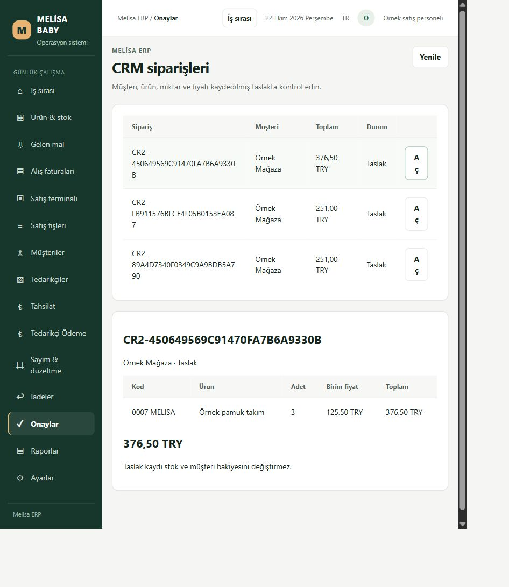

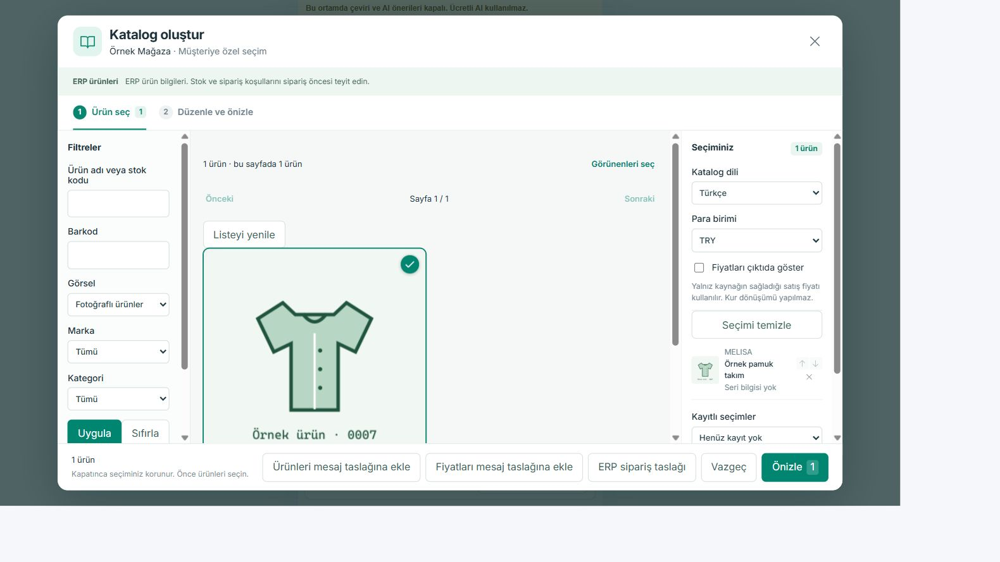

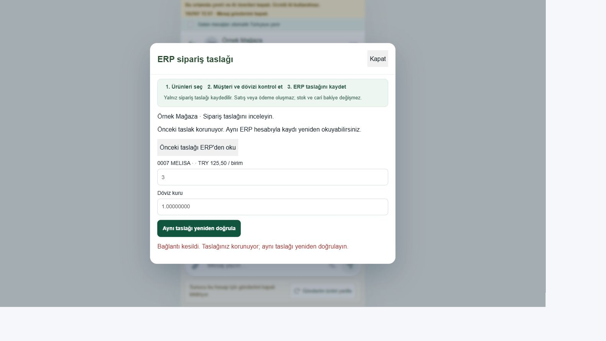

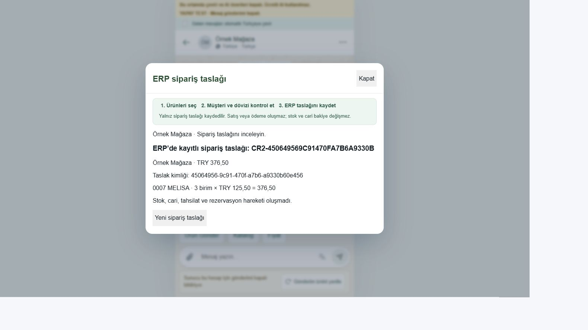

ERP970cfc2 exact [PR CI](https://github.com/melihsnyldzz-ui/melisa-erp-v2/actions/runs/39764410141) / [push CI](https://github.com/melihsnyldzz-ui/melisa-erp-v2/actions/runs/39764404384) SUCCESS; CRM1dd07d1 exact [PR CI](https://github.com/melihsnyldzz-ui/melisa-crm/actions/runs/39764301807) / [push CI](https://github.com/melihsnyldzz-ui/melisa-crm/actions/runs/39764294296) / [AI offline](https://github.com/melihsnyldzz-ui/melisa-crm/actions/runs/39764301782) SUCCESS. Son belge HEAD kaynak/paket CI'sinden ayrıdır.

---

## Tarihsel ilk kurulum —100/a24

ERP-DEC-068'in teknik kurulum kanıtıdır. Eski P03/Shared devralmanın, bütün ürünün veya insan kabulünün tamamlandığı anlamına gelmez. Önceki kayıtlar korunur.

| Alan | Gerçek sonuç |
|---|---|
| ERP uygulama source | `100a9a5596a9d7b2aff27230b03e3a8fbcc03aa1` / PR54 |
| ERP kurulu kimlik | `CLEAN-ERP-20261022-100a9a5596a9` |
| CRM uygulama source | `a24c00d017ffb76814101013754b70a01cda3a3c` / PR3 |
| CRM kurulu kimlik | `CLEAN-CRM-20261022-a24c00d017ff` |
| CRM frontend build source | `334fef95f485098e8dd3bd2a3f1a817f3c686ad0`; sonraki a24 yalnız gateway/test/doc değişikliği |
| Veri alanı | `Semih\MELISADEV / MELISA_ERP_CLEAN_TEST_20261022`, yalnız yapay kayıt |
| Kimlik | `e662fd94-d797-4b3b-938a-d143ad758b67`, immutable; synthetic=true / actualT1=false / externalOperations=false |
| ERP | `http://127.0.0.1:5244/ornek-akis.html#stock`; API4194/native4196 |
| CRM | `http://127.0.0.1:62800/`; gateway62801/catalog62802/orders62803 |

## Gerçek teknik sonuç

- Normal ERP authService ile ayrı nonadmin yapay personel login/refresh/logout; normal CRM scrypt/JWT kullanıcı/rol/atama yolu çalıştı. Eski hesap/parola/rol değiştirilmedi; auth bypass veya eski TEST ADMIN/personnel issuer kullanılmadı.
- Gerçek SQL katalog3 ürün, üç ayrı TRY/USD/EUR fiyat, baştaki sıfırı korunan barkodlar, stok24/12/0. Ürün1 için programatik örnek görsel: merkezi yeni runtime'da PNG320 + thumbnail64, SHA256 ve immutable metadata; SQL binary yok. Eski gerçek fotoğraf taşınmadı, Vega provenance uydurulmadı.
- CRM normal personel atanmış konuşma55'i, yönetici aynı konuşmayı okudu; başka personel403. CRM'de ilk fotoğraflı filtre1 ürün döndürdü: `0007 MELISA`, `125.50000000 TRY`; thumbnail1359byte. Ürün/fiyat/görsel gerçek yeni ERP HTTP/SQL'den geldi; JSON ürün/sipariş motoru yok. Konuşma içeriği yalnız açıkça yapay metadata projection'ıdır; gerçek müşteri mesajı yok.
- Mevcut native v2 SQL writer/transaction/CAS/replay/immutable receipt motoru kullanıldı. Tek yapay örnek request `89a4d734-0f03-49c9-a9bd-b5a790521021`, order1, ürün1×2, toplam251.0000TRY. Normal CRM→ERP HTTP geri okuma ve replay aynı order1 döndürdü; aynıUUID/farklıbody409; yanlışfiyat51204; yetkisiz ERP okuyucu create51201.
- Normal ERP mevcut `/api/sales-orders` okuyucusu aynı siparişi ve satırı geri okudu. Yeni profilin mevcut Onaylar bölümünde salt okunur CRM taslak listesi/ayrıntısı bu okuyucuya bağlıdır; burada satış onaylama/finans yazması açılmadı.
- Bağımsız SQL:1order/1line/1request journal; stok hareketi0, satış/alış faturası0, cari bakiyeleri0, stok24/12/0,8SQLdefinition/8hash. Yeni draft stok, borç, tahsilat veya rezervasyon yaratmadı.

## Giderilen somut eksikler

1. Yeni şemada filtreli indeksin SQL oturum seçenekleri: yalnız yeni alanın eksik şeması tamamlandı; DB yeniden oluşturma/restore yok.
2. Yeni hedef için sonlu SQL/port/normal auth ve yapay provenance dalı eklendi; eski TEST/Shared/LIVE guardları korunur. SQL login eski/gerçek DB'lere erişemez, sysadmin/control0.
3. Gerçek CRM katalog denemesi `ERP_SOURCE_IDENTITY_REQUIRED` verdi: gateway'nin eski CANONICAL_TEST literal beklentisi yalnız exact clean profile için ayrı kimlik kanıtıyla düzeltildi. Eski kimlik kontrolü genişletilmedi.
4. ERP'nin gerçek SQL BIGINT string ID'si yeni readonly UI adapterinde dar şekilde normalize edildi. Baştaki sıfırlı/üs biçimli/unsafeID hâlâ reddedilir.
5. Yeni bağlam importunun config-only VM test bağımlılığı ve iki literal hata kodunun kapalı logger kaydı tamamlandı. Kontroller atlanmadı.

## Yeniden açma, koruma ve kanıt

Yalnız yeni6process/7port kapatılıp açıldı. Yeni source/SQL/safety/normal HTTP geri okundu. Önceki16listener adres/PID/creation-time kaydı birebir aynı. Önce/sonra bağımsız yeniSQL ticari readback SHA256:

`de41d06cb539a730857b00aff9717e860bce21eaf0551a29ce9795cda2c7ef4a`

Bu SQL restore veya gerçek Windows reboot/logon provası değildir. Eski TEST125/DB02/Shared, migration geçmişi, karantinalar, LL dışlamaları, maliyet/fotoğraf/cari aktarımları ve yedekler üzerinde işlem yapılmadı. Çalışan eski servisler stop/restart edilmedi. Geri dönüş sınırı yalnız doğrulanmış yeni process'leri durdurmaktır; yeni SQL/order kanıtı saklanır. Eski DB'ye restore/reset veya eski P03 claim replay yok.

Private makbuz: `C:\Sirket\ERP\clean\20261022\runtime\installation-receipt.json`. Burada gerçek PID/executable/path/creation, source/paket, served-index eşliği, normal API/SQL ve restart kanıtı bulunur. Backend credentials DPAPI+owner/SYSTEM ACL alanında kalır; frontend bundle'a taşınmaz. Ham ticari veri, private config, parola/JWT/token veya fotoğraf arşivi GitHub'a yüklenmedi.

HTTP'den alınan HTML byte'ları gerçek dist dosyalarıyla eşleşti:

- ERP index SHA256: `2f4b180c152a1100df4c36aee0b1efcbc78b4d32af835a6adf86709c6c14fe9d`
- CRM index SHA256: `8478510ca6b0d8db305573d2e7698df3eceeb998949adf6e1a3b2bf449d32104`

Kolay açılış: `C:\Sirket\ERP\clean\20261022\Melisa-TEST-Ac.cmd`. Mevcut yeni servisler açıksa adresleri açar; tamamı kapalıysa yalnız bu yeni hedefi başlatır; kısmi/yanlış hedefte ikinci kopya veya otomatik kurtarma yapmaz. GUI açılış kabuğunun gerçek reboot/logon kabulü verilmedi; altında kullanılan yeni startup adımları gerçek kurulumda çalıştırıldı.

## Test, CI ve açık kalan gerçek sınır

Değişen davranışa yönelik106 hedefli test,22 CI uyumluluk regresyon testi, son BIGINT kimlik kontrolü ve normal ERP/CRM build'leri geçti; bu sayılar birbirine eklenmiş bir ürün kabul sayısı değildir. ERP kaynak incelemesi ve CRM gateway regresyonu bağımsız incelendi. ERP100a9a5 exact PR CI quality-build-test/secret-scan/windows-startup-test SUCCESS. CRMa24c00d exact PR/push aynı üç kontrol ve ai-sales-offline SUCCESS. Son belge commit'inin CI durumu uygulama kaynak sonucundan ayrıdır.

Graphify saltokunur sorgusu5670node/13246edge yanıtladı; önceki erişim engeli kalkmış. Defender istisnası/koruma kapatma yapılmadı; Microsoft incelemesi kurulum için aşılmadı.

**Normal iki uygulamanın giriş sayfası gerçek tarayıcıda açıldı; oturum içi ürün/katalog/sipariş GUI DENENMEDİ/BLOCKED.** Korumalı ilk GUI credential aktarımı desteklenmediğinden bu sınır API login/SQL/CI ile PASS yapılmadı. Parola istenmedi, credential/token/cookie/clipboard/enjeksiyonla ret dolanılmadı. Private screenshot'lar `runtime/erp-normal-login.jpg` ve `runtime/crm-normal-login.jpg`; giriş sayfası kanıtıdır. İnsan/cihaz kabulleri ve özgün bitiş sayaçları değişmez.

Sıradaki tek iş desteklenen korumalı normal GUI ilk giriş devri ve mevcut kabul ID'leriyle oturum içi denemedir. Yeni finans/migration/LIVE/ticari kayıt, gerçek müşteri mesajı, ücretli servis, main merge veya başka Goal başlatılmadı.
