# 22 Ekim — Korunan temiz TEST ve mağaza günü teknik kanıtları

## 23 Ekim 02:56 TR — LAN erişim onarımı

Kullanıcı iki ağdan sayfaların açılmadığını bildirdi ve sonra kapsamı **normal işyeri iç IP'si** olarak daralttı. 02:52 salt okunur incelemede temiz4194/4196/5244/62800–62803 portlarında dinleyici yoktu. IP192.168.1.46 değişmemiş; Windows son açılışı20Ekim. Uygulama kayıtlarında kapanış nedeni bulunamadı. Önceki sunucu tarayıcısı kanıtı başka cihaz kabulü değildir; süreçlerin neden kapandığı halen **BİLİNMİYOR**.

Mevcut `Melisa-TEST-Ac.cmd` 02:54:17'de bir kez başlatıldı. Önce kaynak ERP035fcc08/CRMbc8, boş hedef portları, önceki53veri özeti ve korunacak eski dinleyiciler doğrulandı; eski log/PID/starter dosyaları private before-image alanına kopyalandı. Yeni installer/build/migration/restore/izin değişimi yok. Başlatan cmd64264 ve PowerShell61624 tamamlandıktan sonra altı temiz uygulama süreci çalışmaya devam etti.

Gerçek normal GUI soğuk açılışta dar bir kodlama kusuru gösterdi: WindowsPowerShell5, UTF8 BOM'suz `start-crm.ps1` içindeki Örnek Mağaza sabitini yanlış çözümlüyordu. UTF8 çözülmüş kaynak metni birebir korunarak yalnız BOM eklendi; bu üç temiz CRM süreci exact PID/doğum/executable/entry/parent kontrolünden sonra bir kez yenilendi. ERP üç süreci korunurken CRM adı doğru Türkçe gösterdi. Uygulama source veya frontend değişmedi; değişmeyen kaynak CI tekrarlanmadı.

| Kontrol | Gözlenen sonuç |
|---|---|
| ERP normal LAN girişi | ornek-satis; üç yapay ürün,0007 kartı23ADET/125,50TRY/fotoğraf/0000000000007barkod |
| CRM normal LAN girişi | ornek-personel; atanmış Örnek Mağaza ve aynı0007fotoğraf/125,50TRYkataloğu |
| Yenileme | İki normal oturum korundu; CRM Türkçe adı düzeldi |
| Başlatıcı tamamlanması | cmd64264/PS61624 ve düzeltme başlatıcısı476 kapandı;6uygulama/7port/11listener açık |
| Koruma |53veri kapsamı aynı;21eski listener adres/PID/doğum/executable aynı; firewall profilleri aynı |
| Uzak cihaz/Windows reboot/personel | BEKLİYOR; sunucu üzerinden LAN adresinin açılması bunların yerine geçmez |

Private kanıt: `runtime/lan-recovery-20261023T025358/` altında önce/sonra özetleri, eski loglar, normal ekran görüntüleri, başlangıç ve encoding makbuzu. `result.json` SHA256 `FB6E34955E052FE7CFDF63D55674174F492511C5AE57C04A1ADF4024EC91306A`. İlk süreç karşılaştırmasındaki JSON tarih dönüşümü farkı UTC anları karşılaştırılarak ayrıldı; gerçek eski süreç farkı0. Kaynak/kurulum/güvenlik ayarları veya ticari veri değişmiş gibi sunulmadı.

Kullanıcının açacağı mevcut adresler: [ERP LAN](http://192.168.1.46:5244/ornek-akis.html#stock) · [CRM LAN](http://192.168.1.46:62800/). Tailscale üzerinde bu onarım turunda teşhis veya ayar değişikliği yapılmadı; eski hizmete dokunulmadı.

## 23 Ekim — Esas TEST ağ teslimi

Kullanıcı aynı temiz kurulumu sonraki çalışmaların esas TEST sürümü seçti; şirket ağı ve Tailscale erişimini açıkça yetkilendirdi. Eski kurulumlar korunur. Bu kayıt önceki tarihlerdeki “yalnız loopback” ve eski kaynak kimliklerinin güncel karşılığıdır; eski kanıtlar silinmedi.

| Bileşen | Gerçek kurulu kaynak / hedef |
|---|---|
| ERP | `035fcc08d8f56cdd0cbc437a290285328fce1ec9` / `CLEAN-ERP-20261022-035fcc08d8f5` |
| CRM | `bc8c307ee29f115b2bb7fd4e61f87e9bf482ba54`; mevcut c8 frontend ile kaynak farkı0 |
| SQL | Semih\\MELISADEV / MELISA_ERP_CLEAN_TEST_20261022; env e662fd94-d797-4b3b-938a-d143ad758b67 |
| Güvenlik | synthetic=true; actualT1=false; externalOperations=false; app sysadmin/DBcontrol/eskiDB/LIVE erişimi0 |
| Web | ERP5244 ve CRM62800:127.0.0.1,192.168.1.46,100.87.188.3 |
| İç servisler |4194/4196/62801/62802/62803 yalnız127.0.0.1 |

**Uygulama:** Mevcut installer ValidateOnly→Apply; altı yeni temiz süreç kontrollü yenilendi. Kaynaklar ff-only, exact commit/DB/port/env/before-image doğrulandı. Yalnız uygulama değişti; SQLrestore/reset/migration/ticari yazma0. Yeni bağlardan sonra11clean listener var. Önceki21eski listener adres/PID/doğum/executable ve bütün firewall kuralları aynı. Mevcut onaylı Node TCP izni kullanıldı; yeni firewall kuralı veya yönetici yükseltmesi yok. Exact interface bind, LAN/24 ve sonlu Tailscale peer listesi; yabancıHost/Origin/forwarded başlığı reddedilir. API/native ağda dinlemez.

**Gerçek ekran:** Şirket ve Tailscale IP'lerinin her ikisinde normal ornek-satis/normal ornek-personel girişleri açıldı. ERP3yapay ürün;0007 MELISA fotoğrafı/23ADET/125,50TRY,0161/12ADET/8,55USD,0205/0ADET/10,25EUR ve baştaki sıfırlı barkodlar okundu. CRM atanmış Örnek Mağaza→Katalog0007fotoğrafı/125,50TRY okudu. ERP Onaylar mevcutCR2-450649569C91470FA7B6A9330B→CRS-20261022-3 tamamlanmış satışını salt okunur gösterdi; yeniden satış yapılmadı. TailscaleERP veCRM sayfa yenilemesinde normal oturum korundu. Ajanın iki ağ adresine **sunucu bilgisayarından** erişmesidir; başka fiziksel cihazdan sonuç değildir.

**Negatif sınırlar:** İki ağ × ikiweb'de yanlışOrigin veforwarded başlık8/8HTTP403; ikiERPweb'de authsizkatalog2/2HTTP401. Normal giriş dışında yetki değişimi yok. Önce/kurulumsonrası/GUIsonrası53/53 veri kapsamı aynı; ticari işlem ve kaynak verisi korunur. Wi-Fi/Tailscale başka cihaz, TC21, gerçek Windows reboot/logon ve personel kabulü **DENENMEDİ/BEKLİYOR**. MevcutADBdevice/mDNS bulunmadı; yalnız TailscaleTC21online bilgisi cihaz ekranı kanıtı sayılmadı.

**Hata ve test:** LAN HTTP'de bulunmayabilen crypto.randomUUID yerine mevcut güvenli tradeUuid kullanıldı; crypto yoksa kapanır, retry aynıUUID taşır. Logger yalnız exactCLEAN_TEST_ORIGIN_REJECTED kodunu tanır, private suffix gizlenir. ÜçVMtestloader gerçek yeni modül bağına uyarlandı; assertionlar gevşetilmedi. Tam1034UI testi ve29logger/clean kontrolü geçti;79öncekihedefli/21ilgili kontroller bu sayılara eklenmiş kabul sayısı değildir. Frontend65c6342f build'i ile kurulu035davranış farkı0. Mevcut koordinatör bağımsız kaynak review0P1/P2. ERPPR54 [PR39868737448](https://github.com/melihsnyldzz-ui/melisa-erp-v2/actions/runs/39868737448) ve [push39868730251](https://github.com/melihsnyldzz-ui/melisa-erp-v2/actions/runs/39868730251)6/6SUCCESS. CRMPR3 exactbc8 PR39868432842/push39868425461/AI39868432917:7/7SUCCESS. Belge commit'i kurulu uygulama değildir.

**Private makbuzlar:** `runtime/network-install-20261022T230726Z/result.json` SHA256 `522D3FF4D22D70864E2729F4963F9B7C63EE974F24A4189D38BAD8CC8C015220`; aynı kökte `network-gui-proof.json` SHA256 `6B32F09BACEA99AE0489A45CB504D4101F464559172EFDD0BCCB34CFA4C9E941`. Kurulum makbuzundaki GUI=PENDING o andaki durumdur; sonraki ayrı GUI makbuzu bu sınırı tamamlar. Yedek `backups/before-network-20261023.bak`: COPY_ONLY/CHECKSUM/VERIFYONLY, SHA256 `82978C57F1E258995178381FAE385479716B4DE6001237AAB8765967E6DE3DD0`; gerçek restore yapılmadı. Sırlar/ham veriler/özel ayarlar/yedek GitHub'a taşınmadı.

### Eski adres envanteri — korundu, yeni esas giriş değildir

| Adres / servis | Gerçek kimlik | Şimdiki sınıf |
|---|---|---|
|127.0.0.1:5194;API4144/native4146 |TEST125 runtime klasörü; health source edb3c8915ef0e8c80ef911ced83bc2c1d1dceb0d; MELISA_ERP_SIRKET_TEST_20260929_01 |Çalışıyor, eski TEST |
|127.0.0.1:5234;API4184/native4186 |source e59e07abf7ae2567cdc2adb93811fe29e0032fe5; MELISA_ERP_CRM_SHARED_TEST_20261009_02; copy e16b70f0-4057-428b-9abc-6bbcaf35fe82/T1false |Çalışıyor, eski ortak TEST |
|127.0.0.1:62700;62701–62704 |crm-shared-test-6bc82e6fe9726261ef1d0171d97e5d9da9f5398a runtime |Çalışıyor, eski CRM |
|5188;4114/4116 |C:\\do-wt\\melisa-production-20260918; start-production-web/erp/native.mjs |Çalışıyor, üretim isimli korunan eski servisler; DB bu görevde sorgulanmadı |
|5173 |WildcardVite listener; kaynak checkout/DB bu kapsamda tam doğrulanmadı |Çalışıyor; kimlik BELİRSİZ, “gereksiz” sayılmadı |

Yeni esas girişler [ERP LAN](http://192.168.1.46:5244/ornek-akis.html#stock), [CRM LAN](http://192.168.1.46:62800/), [ERP Tailscale](http://100.87.188.3:5244/ornek-akis.html#stock), [CRM Tailscale](http://100.87.188.3:62800/). Rehber: `C:\\Sirket\\ERP\\clean\\20261022\\GIRIS-REHBERI.md`. IP rezervasyonu bu görevde yapılmadı; adres değişirse finite ağ kimliği yeniden doğrulanır.

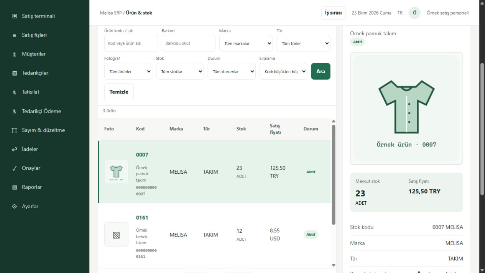

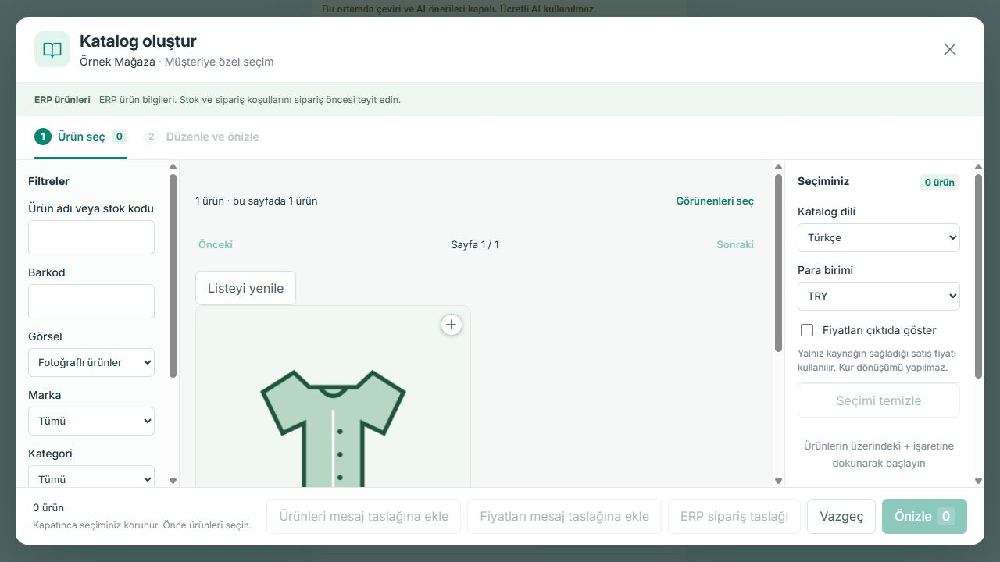

## 23 Ekim — Yeniden deneme sonucu gerçek kurulum ve ekranlar

Kullanıcının izin ayarı değişikliği sonrası doğrudan yeniden deneme talimatıyla mevcut desteklenen escalation yolu çalıştı. Önceki reddin kök nedeninin veya sağlayıcı hatasının düzeltildiği iddia edilmez; yalnız bu çağrılar artık gerçekten yürüdü. Güvenlik kapatma/ret dolanma/yeni helper/ajan/Goal yok.

**Çalışan uygulama:** ERP759bbc62ff2b03341860e2f865101c23dbd596ee / CLEAN-ERP-20261022-759bbc62ff2b; CRM c8d0e28f0ea6cf16133c87dd548a4281381abfb7. Aynı cleanDB/envE662FD94, synthetic=true/actualT1=false/external=false; ERP4194/native4196/web5244/CRM62800–62803. Önce b2a55bba kurulup2.6normalGUI kanıtlandı.2.7router'ının temiz sunucuya hiç bağlanmadığı gerçek ekranda görüldü; mevcut requireAuth+3GET router yalnız4194'te bağlandı. Yeni finans/rol/şema mantığı yok. Koordinatör source ve installer farkını bağımsız inceledi.16hedefli rapor testi PASS; [PR39862025248](https://github.com/melihsnyldzz-ui/melisa-erp-v2/actions/runs/39862025248), [push39862017901](https://github.com/melihsnyldzz-ui/melisa-erp-v2/actions/runs/39862017901):6gerekli check completed/SUCCESS. Belge teslimi çalışan uygulamadan ayrıdır.

**Kurulum/koruma:** Mevcut installer'ın ValidateOnly→Apply yolu,7yeni loopback listener/6PID ve16korunan eski listener kimliğiyle iki kez uygulama güncelledi; CRMsource değişmedi, bağımlı ERPpini yenilendi. NativeSQL veri/şema yazısı veya restore yok. İki kurulumda53kapsam before/after özeti eşit; son rapor/API/GUI okumaları sonrası da aynı. Önceki791→b2veb2→759 starter/dist/git before-image'ları özel arşivde korundu. COPY_ONLY/CHECKSUM+RESTOREVERIFYONLY geçti; gerçek restore yapılmadı.

Özel kanıtlar (ham SQL/credential dosyaları GitHub'a alınmaz):

- runtime/inventory-app-install-20261022T215308Z/result.json ve reports-app-install-20261022T220637Z/result.json: INSTALLED_READBACK_OK/dataUnchanged=true/protectedListeners16/sqlRestore=false.
- before-inventory-app-20261022T215059Z.bak SHA43DAC60745773A63FE2CDF5BD4EBD28BEA39445E28C47A797C290534B101C277; son provadan sonraki before-reports-app-20261022T220411Z.bak SHA2D2188C22446DB6FCC3CD718A592C3027E5F0D4140B478D4FDBF76F999DCEE47.
- runtime/inventory-gui-sql-readback.txt; reports-api-readback-20261023.json; reports-gui-after-data.txt; launcher-actual-readback-20261023.json.

### 2.6 — Normal personel ve sorumlu ekranları

|İşlem|Normal ekran sonucu|Bağımsız SQL / korunma|
|---|---|---|
|Sayım10|Personel21,0007MELISA/barkod0000000000007,23sistem/24sayılan;+1 farkı gönderir; kendi onay düğmesi yok|Pending ikenstok23;created_by21|
|Sayım onayı|Sorumlu22 gerekçeyle uygular; aynıUUID GUI tekrarında ikinci etki yok|stock_count10 +1;stok24;decided_by22|
|Sayım ters kayıt|Gerekçeli iptal ve tekrar doğrulama; yenilemede geçmiş korunur|stock_count_cancel10 −1;stok23;taslakcancelled|
|Alış iadesi|Personel21,alış4/kabul3'ten1adet taslak11; maliyet personelde redakte. Sorumlu22'de60TRY veonay|invoice_return3 finalized;stok−1→22;tedarikçi−60TRY;özgünalışaynı|
|İade ters kayıt|Sorumlu gerekçeli geri alır; yenilemede “Ters kayıtla geri alındı”|stock+1→23;tedarikçi+60→0;taslak11/iade3cancelled;özgün kayıtlar silinmez|

Son ürün1stok23/maliyet60, ürün2/3stok12/0; müşteri0/tedarikçi0/kasa256,50TRY;1satış/1alış/2müşteri/2kasa hareketi korunur. Stok6hareket, tedarikçi4hareket; aktifintent0.60TRY yalnız önceki etiketli sentetik maliyet girdisidir. Eski satışmaliyet snapshot'ıNULL kalmıştır. Fiziksel sayım/gerçek mağaza veya insan kabulü değildir.

**Açık küçük ekran eksiği:** Sayım geçmişi “Sayan: Satış ekibi” sabit etiketini gösteriyor. Kaydın gerçek created_by21/decided_by22 kimliği doğru; bunu yeni bir yetki hatası veya yanlış yazan aktör diye sunmuyoruz. Etiket düzeltmesi bu rapor bağlantısı teslimine eklenmedi.

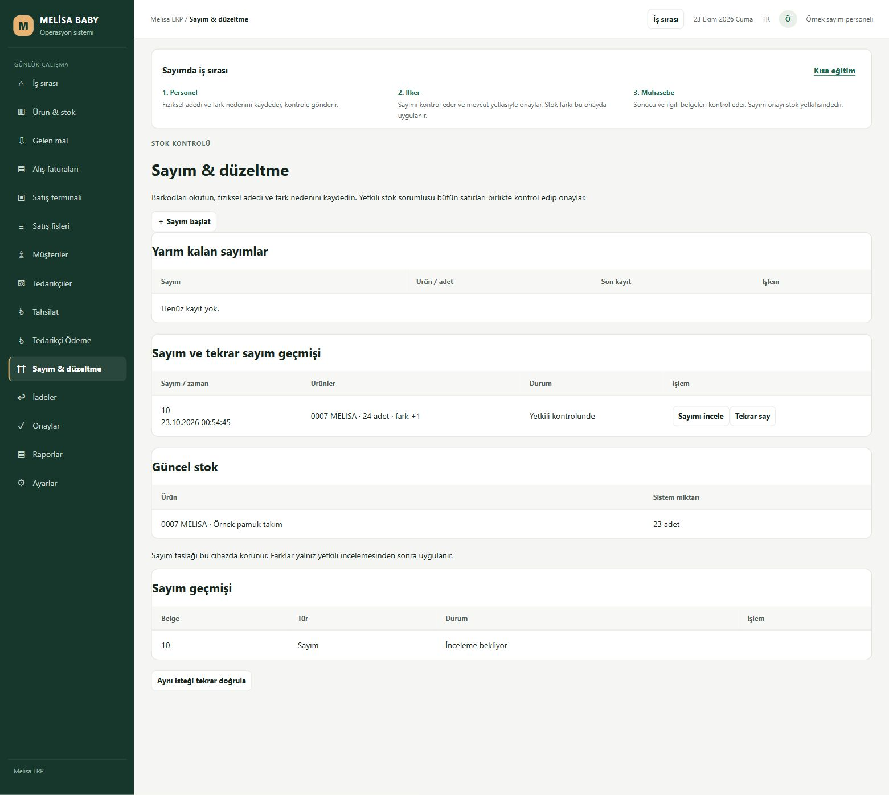
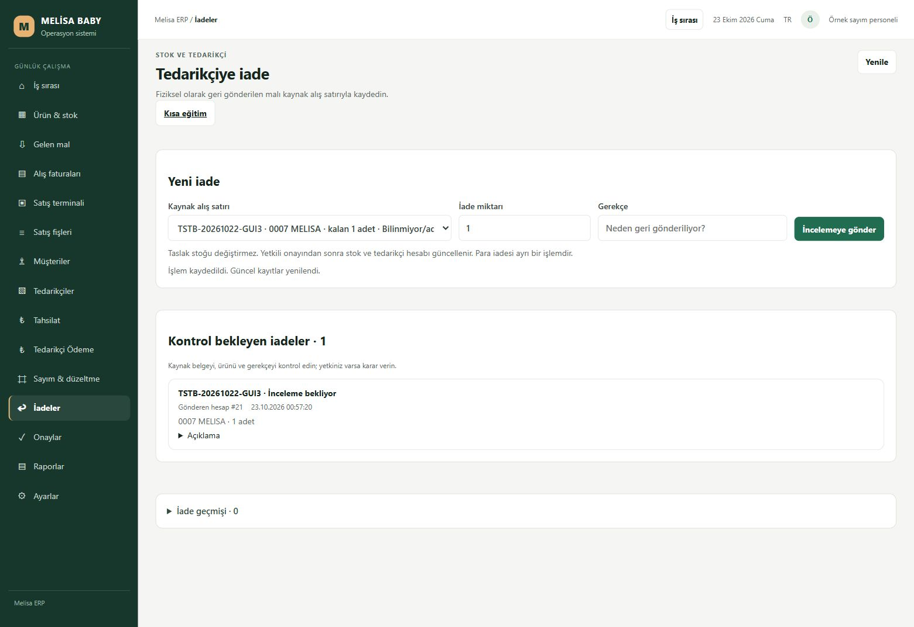
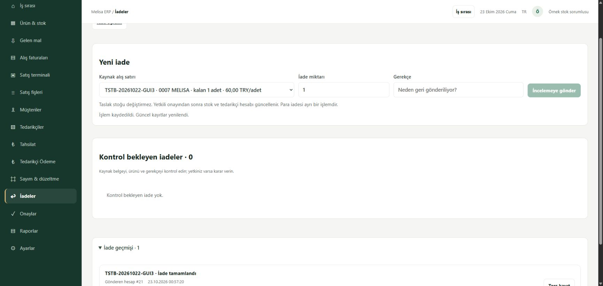
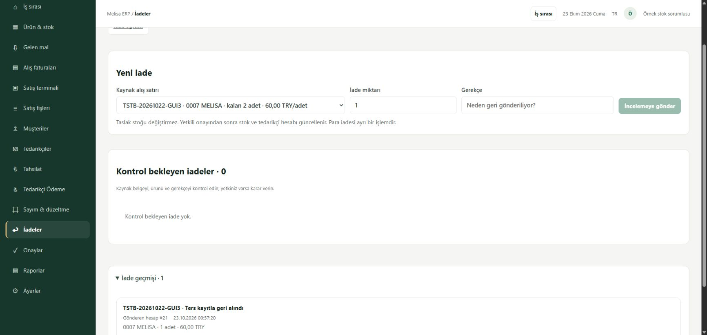

### 2.7 — Kurulu yedi rapor, aynı gün, doğru roller

Normal17satış,20muhasebe,22stok-sorumlusu oturumlarında7rapor gerçekten açıldı; yetkisiz türler kapalı.22Ekim kapsamı aşağıdaki kayıtlarla eşleşti.23Ekim/Bugün boş sonucu geçmişe sabitlenmedi. Son7gün aynı kayıtları kapsadı; belge tarihi22Ekim, gerçek prova zamanı23Ekim olarak ayrıdır.

|Rapor|Kayıt|TRY sonucu|Normal GUI + bağımsız API/SQL|
|---|---:|---|---|
|Satışlar|1|376,50|CRS-20261022-3|
|Tahsilatlar|1|376,50|Aynı satışın tahsilatı|
|Alışlar|1|120,00|TSTB-20261022-GUI3|
|Tedarikçi ödemeleri|1|120,00|Aynı alışın ödemesi|
|Müşteri hareketleri|2|Borç376,50/alacak376,50/net0|Satış+tahsilat|
|Tedarikçi hareketleri|4|Borç180/alacak180/net0|Alış+ödeme+iade+ters kayıt|
|Stok hareketleri|6|Parasal toplam yok|−3,+2,+1,−1,−1,+1; kapanış23ayrı|

MarkaMELISA gruplamasında3ADET/376,50TRY; farklı dövizler toplanmadı. USD/EUR “kayıt yok” bu dövizlerin banka/açılış bakiyesi0kanıtı değildir. Kasa256,50yalnız mevcutTRYhesabı/önceki finans paneli veSQLile karşılaştırılır; yeni kasa raporu uydurulmadı. SatışNULLmaliyet güncel60ile doldurulmadı ve kâr hesaplanmadı.

Normal Chrome CSV düğmesi1alış/120TRY dosyasını Downloads'a indirdi, içerik ve tarih/döviz/kapsam okundu. Download-event bekleyicisi timeout döndürdü, ancak gerçek dosya mevcut ve SHA B696780A486947D4C10C9F68EB4A462B9CA501018ED9DE84090B96B5AECF3FC4 doğrulandı; uygulama indirimi başarısız diye sınıflandırılmadı. API normalauth→GET7rapor; yanlışraporrol403,oturumsuz401,native4196router404,offset50boş/toplam1. APIkontrol oturumları normal logout ile kapandı, tarayıcı oturumları korundu. Rapor okuması ticari yazma0.

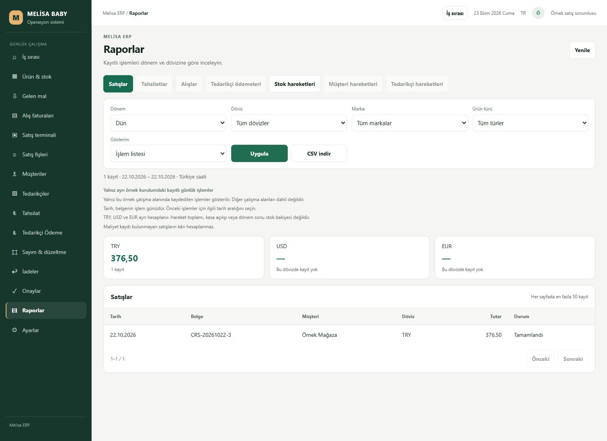
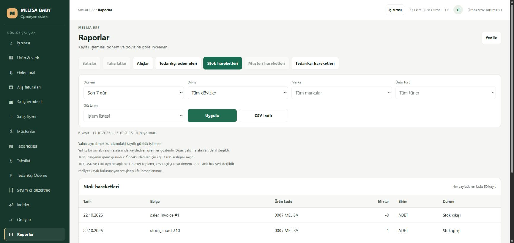

### 5.1 — Mevcut kolay açılış dosyasının gerçek çalıştırılması

Melisa-TEST-Ac.cmd desteklenen izin yolunda tek actual çağrı/exit0. Öncesinde7yeni listener hazırdı; already-running dalı çalıştı. Önce/sonra23listeneradres/PID/doğum/exe birebir aynı; ikinci süreç/restart0. Nativehealth source759/cleanDB/T1false; iki uygulama adresi açma adımı tamamlandı. Bu soğuk servis açılışı veya gerçek Windows reboot/logon değildir; onlar DENENMEDİ. Eski korunan sistem devralınmadı.

**Kullanılabilir adresler:** [Sayım](http://127.0.0.1:5244/ornek-akis.html#count), [İadeler](http://127.0.0.1:5244/ornek-akis.html#returns), [Raporlar](http://127.0.0.1:5244/ornek-akis.html#reports), [CRM](http://127.0.0.1:62800/). İnsan/gerçek cihaz kabulü ve özgün49/25sayaçları BEKLİYOR/aynı. LIVE/Vega/T1/gerçek ticari veri/mesaj/ücretli servis/main değişmedi. Aşağıdaki eski engel kayıtları tarihsel olarak korunur.

## İş2.7 — 23 Ekim salt okunur gün sonu karşılaştırması

### Aynı okuyucunun kaynak düzeltmesi — kurulum ve normal rapor kabulü bekliyor

Mevcut `workReportsReadStore` registered clean context varsa yalnız4194+exactCLEAN_IDENTITY_SQL ile ayrı native temiz şema okumasını seçer. Eski canonical/isolated-copy kimliği veya migration filtreleri gevşetilmedi; başka DB'ye fallback yok. Güncel aktif SQL rol/izinleri ile oturum kesişimi hem context hem her rapor/maliyet projeksiyonunda uygulanır. Native4196/admin shortcut/yanlışDB/kullanıcı/geniş eskiDBerişimi reddedilir. Marka/tür seçenekleri yalnız aynı clean ürün tablosundaki distinct alanlardır; eski16.622ürün snapshot'ı kullanılmaz ve boş marka koddan tahmin edilmez. Desteklenmeyen birim sessizceADET yapılmaz.

Mevcut7rapor/50sayfa/CSV kalır; bu yeni kasa raporu veya stok açılış motoru değildir. Kasa paneli ve sayısal karşılaştırma yukarıdaki mevcut kanıttır. Native stok hareketinin−3/+2 miktarları kapanış23 diye sunulmaz. Finans raporlarında kayıtlı döviz/borç-alacak yönü/ters kayıt işareti korunur, farklı dövizler toplanmaz. Tarih filtresi gerçek bugünü kullanır; örnek22Ekim belgeleri için Dün veya özel22Ekim seçilir. Satış1'in mevcut maliyet snapshot'ıNULL'dır; sonradan girilen kart60 geçmiş satışa taşınmaz. Gerçek0 ile NULL ayrı kalır; kâr hesaplanmaz. Eksik maliyet kapsam yanıtı da sessiz0sayılmaz.

**Kaynak kontrolleri:** Offline guard ile backend16+mevcutfrontend23=39kontrol PASS; değişen ortak batch/clock/dispatch için yalnız3ilgili isolated-copy regresyonu PASS. Bunlar39+3ayrı kontrol, yeni ticari senaryo veya canlıSQLreader kabulü değildir. Aynı minimum SQLapp bağlantısıyla yalnız kimlik ve `HAS_PERMS_BY_NAME(...,'SELECT')` okundu: users/roles/permissions/products/sales_invoices/sales_invoice_items/purchase_invoices/customer_movements/supplier_movements/customers/suppliers/stock_movements12/12yeterli. YeniSQLkullanıcısı/yetki/şema/veri/servis/runtime/installer değişmedi; adaySQLbatch'i gerçek DB'de çalıştırılmadı. Önceki gerçek mağaza günü ve2.6motor provaları tekrar edilmedi. Eski bağımsız reviewer artık aktif olmadığından yeni ajan açılmadı; mevcut koordinatörden yalnız kaynak incelemesi istendi. Exact kaynakCI ve son inceleme sonucu ortak raporda ayrı tutulur.

**Kalan tek kurulum kabulü:** Desteklenen yol açılınca son adayın aynı temiz hedefe kurulup normal rollerde Raporlar→özel22Ekim kapsamı→7rapor/CSV/NULLmaliyet/yanlışrol geri okuması. Bu işlem bu kaynak tesliminde başlatılmadı. Kurulu ERP791/CRMc8 ve önceki ekran görüntüleri değişmedi; yeni normal Raporlar düzeldi denmez.2.6BEKLEMEDE,2.7KISMİ ve insan kabulü aynı.

**Kapsam:** Yalnız 22.10.2026 tarihli kabul edilmiş 2.1–2.5 yapay mağaza işlemleri, 23.10.2026'da yeniden oluşturulmadan okundu. Kullanıcı 2.6 engelini beklemeden devam edilmesini seçti; 2.6 kurulum/normal ekranı **BEKLEMEDE**, 2.7 **KISMİ**. Bu belge insan kabulü veya bütün mağaza gününün kapanışı değildir.

Health/API ve salt okunur SQL kimliği: kurulu ERP `791b82a288adc085380c7827c53b62114bf6d80d`, `MELISA_ERP_CLEAN_TEST_20261022`, environment `e662fd94-d797-4b3b-938a-d143ad758b67`, synthetic=true/actualT1=false/externalOperations=false; CRM c8 aynı. 4194/4196/5244/62800–62803 yedi loopback listener'ı aynı altı süreçte kaldı. Source6e472 kurulu sayılmadı; restart/kurulum/SQL restore/reset yok.

| Karşılaştırma | Mevcut işlemlerden beklenen | Güncel kayıt ve normal ekran | Fark / sonuç |
|---|---|---|---|
|Ürün1 /0007 MELISA|24 başlangıç −3satış +2mal kabul =23ADET|SQL23, normal Ürün & stok23ADET|0; ürün kartı kapsamı doğrulandı|
|Müşteri1 /TRY|0 +376,50satış −376,50tahsilat =0|SQL0; normal Tahsilat müşteri bakiyesi0 ve fiş kalan0|0; doğrulandı|
|Tedarikçi1 /TRY|0 +120alış −120ödeme =0|SQL0; normal Tedarikçi Ödeme borç0 ve OD-5/120geçmişi|0; doğrulandı|
|Kasa1 /TRY|0 +376,50giriş −120çıkış =256,50|SQL256,50; normal kasa hareketleri aynı giriş/çıkış/net ve ödeme hesabı256,50|0; doğrulandı|
|Toplu Raporlar ekranı|Aynı tarih/kapsamda rapor toplamları|“Rapor bağlantısı şu anda kurulamıyor”; toplamlar—/Uygula ve CSV kapalı|DOĞRULANMADI; kapsam bağı eksik|

Belgeler: satış1/CRS-20261022-3, mal kabul3→alış4/TSTB-20261022-GUI3, tahsilatTH-7 ve ödemeOD-5; hepsi22Ekim. Rapor ekranındaki23Ekim/Bugün başlığı bu eski belge kapsamıyla karıştırılmadı. Kasa panelindeki USD/EUR0 yalnız gösterilen hareketlerin toplamıdır; ilgili hesap veya banka açılışının0 olduğu iddia edilmez. Banka hesabı bağlı değil. Diğer ürünler12/0 ayrı kaldı, farklı ürünler toplanmadı. Satış stok hareketinin depo alanıNULL, giriş ORNEK-20261022 olduğundan depo bazında tam stok mutabakatı iddia edilmez.

Tek60TRY maliyet girdisi ve hazırlık anındaki+1380TRY sentetik değerleme, nakit hareketi veya kâr değildir; eski satış maliyeti yeniden hesaplanmadı. Committed2.6inventorydraft/iade/ters kayıt0; native rollback provaları bu günlük toplamına eklenmedi. Son sayımlar3sipariş/1satış/1alış/2stok/2müşteri/2tedarikçi/2kasa hareketi; toplamlar önceki kabul edilmiş kayıtlarla aynı. Normal mevcut TEST girişleri dışında yeni ticari/finans/stok kaydı oluşturulmadı; rol veya ayar değiştirilmedi.

**Rapor engelinin dar nedeni:** Mevcut `workReportsReadStore.runtime` canonical TEST veya isolated operation copy hedefini kabul ediyor; bu ayrı cleanDB için okuyucu kapsam bağı yok. Kurulu791 ve source6e dosyasının SHA256'sı aynı: `C228D8A36BAB06EC0B6D96BE891BF4E56173EFC2F94CA9BAA506046C24FEB70E`. Kimlik kontrolünü gevşeterek veya başka DB'nin raporunu kullanarak kapanış yapılmadı. Aynı mevcut okuyucuya clean kapsam uyarlaması kod/paket gerektiriyor; bu salt okunur turda geliştirme veya kurulum başlatılmadı. 2.6/5.1 retleri de tekrar denenmedi. Özgün insan/cihaz/reboot kabulleri ve49/25 sayaçları aynı.

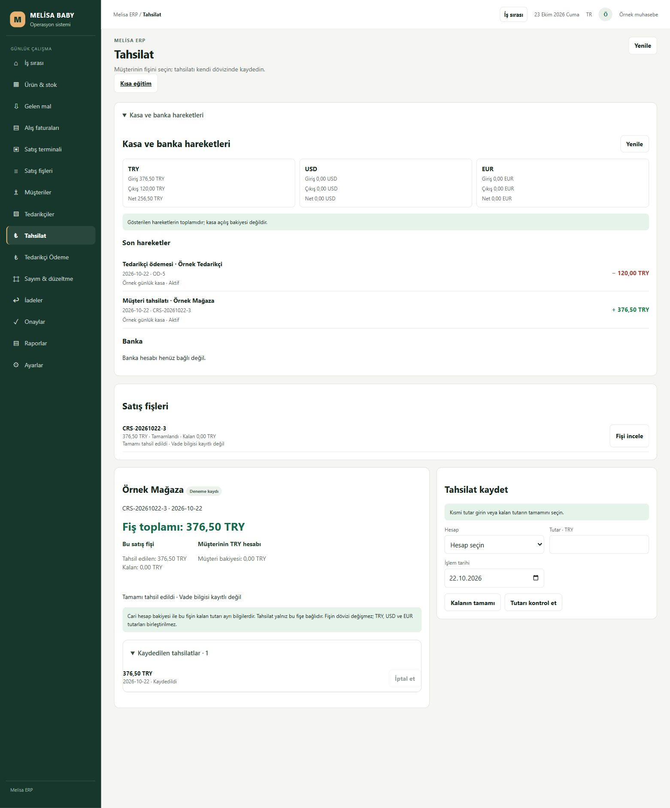
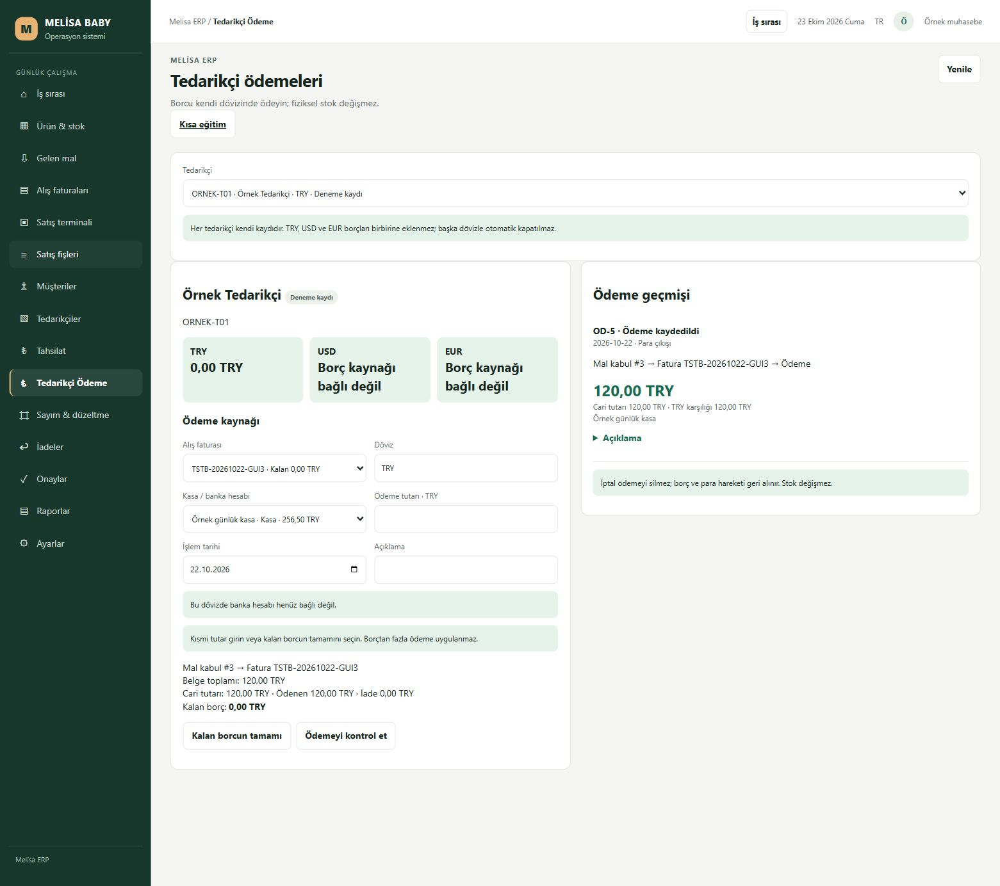
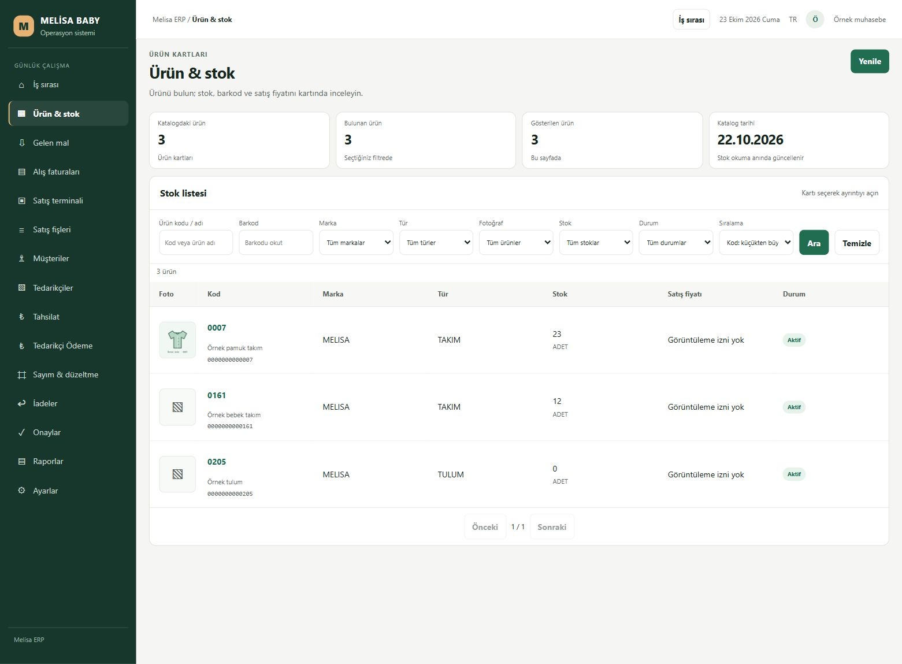
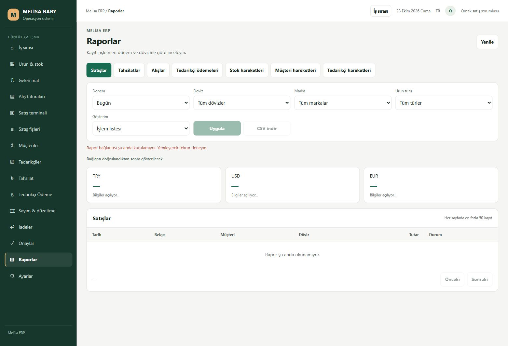

[Stok](http://127.0.0.1:5244/ornek-akis.html#stock), [Tahsilat / Kasa ve banka hareketleri](http://127.0.0.1:5244/ornek-akis.html#collections), [Tedarikçi Ödeme](http://127.0.0.1:5244/ornek-akis.html#supplier-payments), [Raporlar — eksik](http://127.0.0.1:5244/ornek-akis.html#reports). **Sonraki tek iş:** Aynı2.7 toplu rapor okuyucusunun clean kapsam bağını tamamlamak; genel kapanış için kurulum/normal rapor ve daha sonra2.6 tam kapsamı ayrıca gerekir.

## İş 2.5 — Normal tahsilat ve ödeme teknik olarak doğrulandı

Uygulama791b82a exact HEAD'inde PR/push'a ait6CI check-run completed/SUCCESS (quality-build-test,windows-startup-test,secret-scan ikişer). [PR39831103076](https://github.com/melihsnyldzz-ui/melisa-erp-v2/actions/runs/39831103076) completed/SUCCESS; [push39831095888](https://github.com/melihsnyldzz-ui/melisa-erp-v2/actions/runs/39831095888) job'ları başarılı fakat REST workflow aggregate ilk okumada in_progress kaldı. Check-run kanıtı commit/check-runs API'sinden bağımsız doğrulandı; aggregate completed diye değiştirilmedi. Son belge HEAD'i çalışan uygulamadan ayrıdır.

ERP uygulama `791b82a288adc085380c7827c53b62114bf6d80d` / `CLEAN-ERP-20261022-791b82a288ad`, PR54; frontend3bf5c7eb build, sonraki frontend farkı0, HTTP/dist SHA eşit. CRM source/frontend `c8d0e28f0ea6cf16133c87dd548a4281381abfb7`, PR3; yalnız runtime native source/paket pini güncellendi. Hedef yalnız `MELISA_ERP_CLEAN_TEST_20261022`, environment `e662fd94-d797-4b3b-938a-d143ad758b67`, synthetic=true/T1=false/externalOperations=false; ERP5244/API4194/native4196, CRM62800–62803 loopback. İnsan kabulü bekliyor.

Mevcut native financeService ve workCollectionService/workSupplierPaymentService kullanıldı. Eski15–19 rolleri aynı; ayrı örnek muhasebe20/rol25 yalnız gereken finans ve görüntüleme izinlerine sahip. Normal giriş mevcut DPAPI kaydından parola formuyla yapıldı; sır çıktısı/token enjeksiyonu yok. Eski23cohort/12SALE/8draft/2compatibility kanıtına dokunulmadan12finans companion tanımı gerçek SQL'de mühürlendi. Aynı transaction/aktör/izin/hash ve tek etki zorunlu; guard kapatma yok. Native4196 finans yazması403.

| Yapay TEST kaydı | Önce | Normal ekran sonrası |
|---|---:|---:|
| Mevcut satış1 müşteri borcu |376,50TRY|0,00TRY; tek tahsilat|
| Mevcut alış4/kabul3 tedarikçi borcu |120,00TRY|0,00TRY; tek ödeme|
| Yapay kasa1 |0,00TRY|376,50giriş −120,00çıkış =256,50TRY|
| Ürün1 stok |23ADET|23ADET; eski2stok hareketi aynı|
| Eski belgeler |3sipariş/1satış/1alış|Aynı kayıtlar/geçmiş; yeniden oluşturulmadı|
| Finans |0journal/0kasa hareketi|2journal/2kasa hareketi/1tahsilat bağı/0intent|

Tahsilat POST200 ile commit olduktan sonra yalnız cevabı browser ağ aracıyla düşürüldü. Ekran belirsiz sonucu kilitledi; reload sonrası aynı UUID/body korundu, “Son işlemi doğrula”200/replayed ile ikinci tahsilat0. Geçici interception kaldırıldı. Ödeme düğmesine gerçek çift tıklama tekPOST üretti; yenile sonrası aynı `OD-5 → alış4 → kabul3` geçmişi, borç0/kasa256,50; yenilePOST0. İki gerçek GUI isteği API'den ikişer replay edildi:200/ikinci etki0; aynıUUID farklıbody409, native4196POST403, eski15personel tahsilat403. Bağımsız SQL kart/defter/kasa eşit ve native ready geçti.

Native motor sonrası kontrollü hata/rollback ve eski SALE motoru yeni müşteri guard'ıyla önceki gerçek outer-transaction provasında geçti. Son iki düzeltme SQL/finans motorunu değiştirmediği için ticari provalar tekrarlanmadı. COPY_ONLY/CHECKSUM+VERIFYONLY korunur; gerçek restore/reset veya commit sonrası business inverse yapılmadı.

**Gerçek kurulumda düzeltilenler:**5cf statik collection route→auth→database zinciri temiz kimlik kaydından önce gereksiz msnodesqlv8 sürücüsünü seçtirip başlamadı. Çalışan5aa/c8 uygulaması güvenle geri açıldı, DBrestore0.3bf importu doğrulanmış context sonrasına taşıdı; gerçek SQL-auth cold-load ve başlangıç geçti. Normal GUI sonra200liste yanıtındaki eksik `{data,meta}` katmanını gösterdi;791 yalnız RO envelope'u düzeltti.31ilgili test ve mevcut bağımsız incelemede açıkP1/P2=0. İlk installer readback'i uygulamada olmayan yeni purpose etiketi beklemişti; doğru source/native health bağımsız doğrulanınca aynı ERP süreçleri korunup kalan CRMstart tamamlandı. Başarısız aday körlemesine tekrarlanmadı; native sürücü kurulmadı, güvenlik gevşetilmedi.

Eski16listener adres/PID/doğum/executable aynı.20koruma özetinin18business/role/source/history kapsamı eşit; iki users özeti normal15login `last_login_at` ve otomatik SQL `row_version` nedeniyle değişti. İkinci özet yalnız last_login_at'ı dışladığından o da değişir;20/20aynı denmez. Etkili usersUPDATE yalnız last_login_at; eski rol/izin, fiyat/medya/maliyet, sipariş/receipt, belgeler ve eski cari hareketleri eşit. TEST125/DB02/eski DB'lere erişim0; LIVE/Vega/T1/main/gerçek mesaj/ücretli AI yok.

Private makbuz `C:\Sirket\ERP\clean\20261022\runtime\installation-receipt-finance.json`, SHA256 `94d94285f4fed652ff3298042c95d52d9a5b471c1ba292eae49db597adf22cbc`. Native/HTTP/koruma kanıtları private runtime'da; sır/ham ticari veri/yedek yüklenmedi. Görüntüler yalnız yapay TEST'tir.

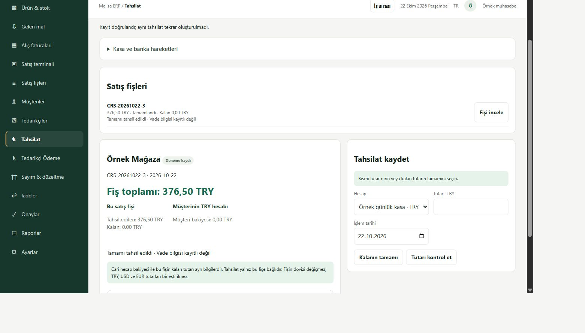
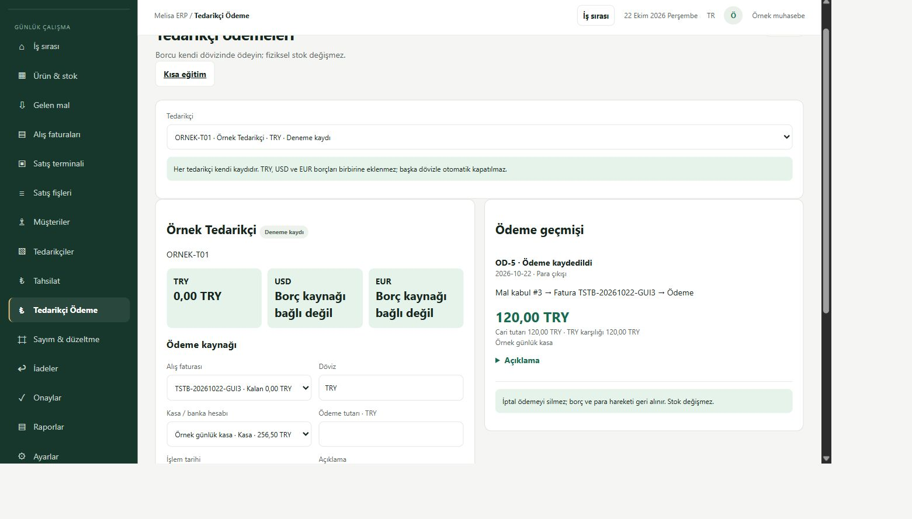
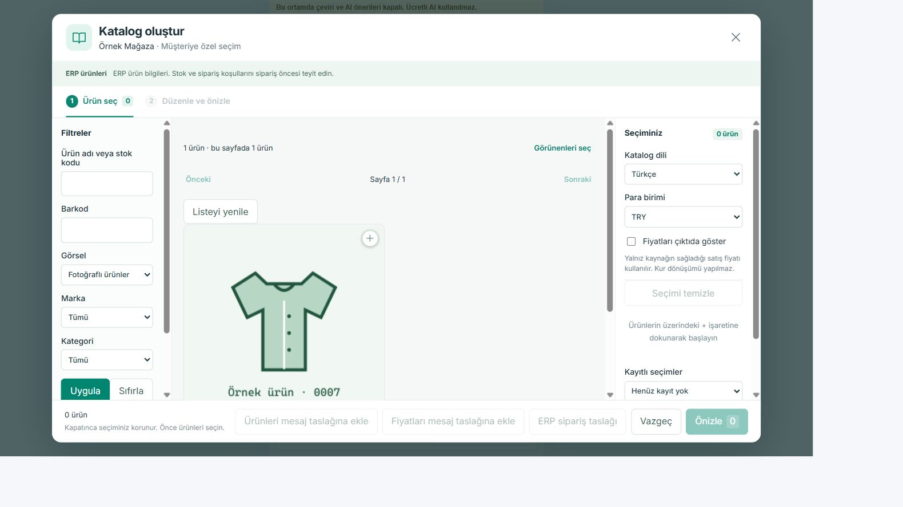

[Tahsilat](http://127.0.0.1:5244/ornek-akis.html#collections), [ödeme](http://127.0.0.1:5244/ornek-akis.html#supplier-payments), [CRM](http://127.0.0.1:62800/). Sıradaki mevcut2.6sayım/iade/iptal, ardından2.7gün sonu. ERP-UA08/14, insan/cihaz/reboot ve özgün49ERP/25CRM kabulleri BEKLİYOR. Yeni Goal/tree/TEST/ajan yok. Aşağıdaki kaynak-only ve eski paket kayıtları tarihseldir.

## İş2.5 ilk SOURCE/OFFLINE dilimi — kurulu tahsilat değildir

Mevcut B06/C08 ve ERP-UA08/14 kapsamında `cleanStoreDayCollectionPreparation.mjs`, mevcut `workCollectionService` tutar/tarih/revision/hash hesabını değiştirmeden kullanır. Varsayılan DB/route/initializer/native writer yok. Yalnız exact clean order3→sale1/customer1/376,5000TRY, güncel izin kesişimi, aynı ortamın tek doğrulanmış yapayTRYkasası ve tam tahsilat geçmişiyle önizleme hazırlanabilir. Dış yetkiler false; collect/cancel her durumda403. Fixture'daki hazır rol/kasa yalnız çevrimdışı varsayımsal girdidir, gerçekten oluşturulmuş hesap değildir.

22Ekim16:32UTC gerçek RO SQL: aynı `MELISA_ERP_CLEAN_TEST_20261022`/envE662FD94/T1false/externalfalse. `finance_accounts`, `finance_account_movements`, `work_collection_links`, `work_trade_requests`, `work_trade_intents` yok. Mevcut normal15–19 rollerinde finance.collection yok; doğrulanmış kasa yok. Genel finance hesap okuyucusu otomatik tablo/varsayılan hesap yazabildiğinden çağrılmadı. Mevcut satış376,5000TRY, müşteri376,5000/tedarikçi120,0000, stok23/12/0 ve3sipariş/1müşteri/1tedarikçi/2stok hareketi RO okundu; hiçbir ticari işlem yapılmadı. Private `.tmp/collection-preparation-target-ro.json` dışarı yüklenmedi.

9yeni+11mevcut20hedefli test offline guard altında PASS; mevcut bağımsız reviewer açıkP1/P2=0. Yanlışhedef/rol/döviz/tarih/kasa, fazla tahsilat, kaynak/geçmiş drift ve tekrar çağrıda yazma403 doğrulandı. Bu, **başarılı native tahsilat/replay/yanıt kaybı sonrası tek ticari etki kanıtı değildir**; o kanıt native owner bağımlılıkları çözülüp ayrı dar kurulum yapıldığında gerekir. Yeni kaynak kurulmadı; ERP5aa/CRMc8/5f8049makbuzu/normal ekranlar aynı.2.5açık,2.6/2.7başlatılmadı; insan/cihaz/reboot kabulleri ve49/25sayaçları değişmedi.

**CI'da yakalanan kaynak kaydı:**8eaeb277'nin PR39815175890/push39815168990 qualityAPI kontrolü, yeni statik CLEAN_COLLECTION_PREPARATION_REQUIRED kodunun logger kapalı listesinde bulunmaması nedeniyle reddedildi. Bütün CI yeşil sayılmadı. Yalnız dört exact CLEAN_COLLECTION hata kodu kaydedildi; prefix/keyfi metin veya sır redaksiyonu açılmadı.38hedefli test ve offlineguard altında tüm API suite1091test:1078PASS/13platformskip/0FAIL. Son source kendi CI'siyle doğrulanır; bu düzeltme de kurulmadı. Dört korunan SQL tam satır SHA özeti4/4aynı.

## Korunan2.2/2.3 kurulu sonuç

**Son CI düzeltmesi yalnız testtedir:**5546d3d5 belgeHEAD'inin PRWindows koşusunda tek eski query-only handle denemesi LIVE_HANDLE ile reddedildi; aynıHEADpush başarılıydı. Deneme toplam3,4sn sürüp ilk aktiflik kontrolünde reddedildi; sabit2,5sn ömürlü çocuk, ilk OpenHandle içindeki tembel C#derleme ve kimlik okuması tamamlanmadan çıkabiliyordu. Fixture artık stdin bekler; ilk PID/aktiflik/doğum kanıtından sonra sinyal/EOF ile doğal çıkar,10sn sınırlıbekleme ve finallyEOF/Dispose temizliği vardır. Tüm nativePID/birth/closed/CIM0 assertions ve productiondriver aynıdır; kontrol/yetki gevşetilmedi. Yerelde eskiEncodedCommandrunner yeniden çalıştırılmadı; yalnızJSsyntax+ilk saf kaynak assertionı1PASS. Gerçek Windows fixture sonucu son PR54HEAD CI'sinde ayrıca izlenir. Kurulu5aa/c8,SQL ve servislerde bu CI düzeltmesi için değişiklik/restart0.

Yalnız yapay mağaza günü kapsamında2.2 ve2.3 normal hesaplarla çalıştı.2.4önceki satış kanıtı yeniden kullanıldı; yeni satış/CRM siparişi oluşturulmadı. İnsan kabulü BEKLİYOR; sonraki2.5tahsilat/ödeme/kasa bu teslimde açık.

| Alan | Son doğrulanmış sonuç |
|---|---|
| ERP uygulama/paket | `5aa4cb3eb143ec1171f0b221e16919d36893883d` / `CLEAN-ERP-20261022-5aa4cb3eb143`, PR54 |
| Frontend |7dc6fac build;5aa ile frontend farkı0; HTTP/dist eşit |
| CRM |c8d0e28source/frontend korunur; yeni native5aa exactsource/paket pini, PR3. PaketID alanı uygulamada yok; uydurulmadı.|
| Hedef |Semih\MELISADEV; yalnız MELISA_ERP_CLEAN_TEST_20261022/envE662FD94-D797-4B3B-938A-D143AD758B67;loopback4194/4196/5244/62800–3;T1false/externalfalse|
| Normal GUI |Depo18count3→submitreceipt3→sorumlu19approve→invoice4draft/finalize; yenile aynı kayıt.|
| Stok/cari |21→23ADET yalnız kabulde; alış kesinleşmesi120TRYtedarikçi borcu; stok23kalır. Önceki müşteri376,50TRY/sale1 korunur.|
| Normal ürün/CRM |0007 MELISA/barkod0000000000007/fotoğraf/23ADET/125,50TRY;0161USD8,55/0205EUR10,25 korunur. CRMatanmış örnek müşteri veorder3/sale1FINALIZEDgüncelGETileokunur.|
| Tekrar/rol |9HTTP kontrolü; aynıUUID/bodyreplay200,aynıUUIDfarklıbody409,personelapprove/purchase403,sıfır400,barkodçatışma409,yanlışdöviz400;native4196POST403. İkinci ticari etki0.|
| Native tanımlar |8originaldraft+12tarihselSALE+2compatibility+23activehash/enableddoğrulandı; guardkapatılmadı.|
| Prova/geri dönüş |Gerçeknative10adım ve eskiSALEnewguardregresyonu dıştransactionrollback ile önce=sonra; COPY_ONLY/CHECKSUM+VERIFYONLY. Gerçekrestore yok; boşcohort inversesi commit sonrası ticari ters kayıt diye sunulmaz.|
| Koruma |Eski16listener birebir aynı.12scope11SHAaynı;old_usersnormalgirişlast_login_atfarkı ayrı. Eskirol/izinler aynı;uygulamadausersUPDATEyalnızlast_login_at. TEST125/DB02/yedekler/Vega/LIVE değişmedi.|
| CI |5aa exact [PR](https://github.com/melihsnyldzz-ui/melisa-erp-v2/actions/runs/39804466004)/[push](https://github.com/melihsnyldzz-ui/melisa-erp-v2/actions/runs/39804453903) SUCCESS/6job. BelgeHEAD ayrı.|
| Makbuz |Private runtime/installation-receipt-store-day.json;SHA256 `5f804901b42bf40d0970cf39e962df6768616939ca28500d7d3e21ab59523c19`.|

İlk actualnative hata dosyaları korunur: eksikdepo kolonları/sourceenum nativealtermigrationuyumuyla düzeltildi; beşeski source enumdeğeri korundu,WITHCHECK trusted kaldı. Native120TRY stock_cost_effect_try bir bedel snapshot'ıdır; ikinci fizikselstokhareketi değildir. UI'de eskiFX adapterinin bucleankapsamda gereksizmount'u ve kayıtlıkurGETprojeksiyonu düzeltildi. Mevcut invoiceDraftService hesaplama/motoru kullanılır; yeni ticari motor yok.94ilgili kontrol/build ve55okuyucu kontrolü örtüşür, toplam sayıya eklenmez. Son kaynakRO açıkP1/P2=0. 8journal=5GUIişlemi+3etkisiz farklıUUIDfinalize tanığı;8ticari işlem diye sayılmaz.

[Mal kabul](http://127.0.0.1:5244/ornek-akis.html#goods) · [Alış](http://127.0.0.1:5244/ornek-akis.html#purchases) · [Stok](http://127.0.0.1:5244/ornek-akis.html#stock) · [CRM](http://127.0.0.1:62800/).

---

## Tarihsel iş1 kurulum: CRM siparişi → normal ERP onayı → tek native satış

ERP-DEC-070'in dar bağlantısı gerçek temiz yapay SQL hedefinde tamamlandı. Bu sonuç bütün mağaza günü, eski Shared/P03 kurtarması, launcher veya gerçek işletme/insan kabulü değildir. Önceki kayıtlar aşağıda tarihli olarak korunur.

**Sonraki aynı iş2 / mağaza günü:**2.1aynı product1/customer1/supplier1 ve başlangıç–mevcut etkileri salt okunur eşlendi (24→21stok,0→376,50TRYmüşteri,0tedarikçi).2.2henüz açık: mal kabul/depo/ayrılmış rol ve native alış adapteri mevcut temiz hedefe bağlı değil. Mevcut stage4 örüntüsünden yalnız3satış guardı için exact-before/after ve eski gövdeyi koruyan offline derleyici, native bind/finish/sameTX receipt kanıtı gerektiren ayrı işlem kapsamı kaynakta hazırlanıyor; kurulum yapılmadı.16hedefli kaynak testinin fake driver sonucu gerçek mal kabul/alış kabulü değildir. Gerçek temiz SQL'de eksik bind prosedürü2812ret verdi; kapsam/callback açılmadı, kısa transaction geri alındı; stok21/müşteri376,50/tedarikçi0/sale1/purchase0/stockmovement1/intent0 öncesi=sonrası. Placeholder19 negatif girdidir, yeni kullanıcı/rol oluşturulmadı. Private `store-day-missing-cohort-proof.json`.2.3iş1kanıtını yeniden kullanacak;2.4tahsilat/ödeme,2.5sayım/iade/iptal,2.6gün sonumutabakatı sıradadır. Yeni Goal/plan/TEST/ajan yok; özgün insan kabulleri/sayaçlar aynı. Aşağıdaki kurulu3db/c8 tablosu iş1'in doğrulanmış sonucudur, yeni kaynak parçasının kurulduğu iddiası değildir.

İş1 için CRM bağımsız kaynak/makbuz/görsel/nihai belge RO eşlemesi de kapandı, açıkP1/P2=0. CRM belge teslimi `5342b4358d8cd7e0ffb606a93fa532e3049e6f55` PR3'tedir; bu docs-only/skipci teslimi c8uygulama/kurulumCI'si değildir. Aynı f923makbuz ve gerçek ekran kanıtı korundu.

| Alan | Doğrulanmış sonuç |
|---|---|
| ERP uygulama source / paket | `3db0830df16d36d59cc69b1a19feb593357aaf35` / `CLEAN-ERP-20261022-3db0830df16d`, PR54 |
| ERP frontend |9f541f98 build; sonraki3db uygulama frontend farkı0; sunulan index gerçek dist ile eşit |
| CRM source / frontend | `c8d0e28f0ea6cf16133c87dd548a4281381abfb7`, PR3; gerçek temiz build yapıldı, sunulan index eşit. Ayrı runtime package-health alanı yok; kaynak/PID/dist kanıtı kullanıldı |
| Hedef | `Semih\MELISADEV / MELISA_ERP_CLEAN_TEST_20261022`, environment `e662fd94-d797-4b3b-938a-d143ad758b67`, synthetic=true / actualT1=false / externalOperations=false |
| Normal personel15 |Mevcut sipariş3,3×125,50TRY; `CRS-20261022-3` fatura1 DRAFT. Stok24/müşteri0; onay düğmesi yok, sorumlu onayı gerekiyor |
| Normal sorumlu17 |Ayrı normal parola formuyla giriş; onay POST200. Aynı fatura1 FINALIZED; stok24→21, müşteri0→376,50TRY |
| CRM normal atanmış personel |Mevcut45064956-9c91-470f-a7b6-a9330b60e456 kayıt ve bağlı satış FINALIZED/CRS-20261022-3/376,50TRY. Yenileme GET200 + `/sale` GET200; yeni taslak/satış POST0 |
| Bağımsız SQL/API |3eskiorder/1invoice/2action/0intent; tek quantity_out3 stok hareketi ve tek376,50TRY müşteri hareketi. Normal ürün API stoğu21, normal müşteri API bakiyesi376,5 |
| Tekrar güvenliği |Aynı finalUUID/body iki eşzamanlı çağrı200/replayed; farklıUUID/aynısipariş200/replayed; aynıUUID/farklıbody409; ikinci fatura/stok/cari etkisi0. Aynı siparişi yeniden taslağa aktarma da replay |
| Yetki sınırı |Personel finalize403; native4196 salePOST403; satış yazması yalnız ERP4194. Native4196 purpose draft-only, stock/ledger capabilityfalse kalır |
| Gerçek rollback |Mevcut native finalize motoru tamamlandıktan sonra kontrollü hata verildi; dış transaction stok24/cari0/DRAFT/action1/intent0 durumuna döndü. Bu prova normal GUI onayından önce yapıldı; geçmişi silen restore/ters kayıt yapılmadı |
| Kaynak koruması |Özgün sipariş başlık/satır/receipt, fiyat, medya/original medya ve eski20/21izinlerinin7before-image SHA'sı birebir eşit.8native+12eski satış+2companion tanım/hash geçerli |
| Eski kurulu sistem |16listener adres/port/PID/doğum/executable birebir eşit; TEST125/DB02/eski ticari veriler/yedekler korunur |
| Yedek |Yeni cleanDB COPY_ONLY/CHECKSUM backup ve RESTORE VERIFYONLY geçerli. SQLExpress COMPRESSION ilk ret kaydı korunur; desteklenen sıkıştırmasız yol kullanıldı. Gerçek restore yapılmadı |

Normal GUI ilk dönüşümünde kaynak sözleşmesinin barkodu NULL bırakması güvenli409ret üretti; fatura/stok/cari etkisi oluşmadı. Mevcut kesin ERP kimliği/kod/ad/fiyat/birim/stok/karantina kontrolü korunarak NULL aynen invoice'a aktarıldı; primary barkoddan tahmin yapılmadı. Eski12immutable tanım değiştirilmeden `begin_v2`+ikiimmutablehash companion eklendi; gerçek olumlu begin/prova rollback'i ve gerçek normal create/finalize ile doğrulandı. Verilmiş barkod için exact eşlik şartı kaynakta korunur. Eski v1barcodedrift ret provası NULLpozitifini kanıtlamadığı için yeni barcode kabulü sayılmadı.

İkinci dar düzeltme: DBkimlik/bağımlılık/transaction başlangıcı da typed503 hata sınırında; SQL ayrıntısı normal ekrana çıkmaz.8hedefli test PASS; mevcut bağımsız kaynak incelemesinde açıkP1/P2=0. İlk GUI retleri ve tüm başarısız prova logları private alanda tutuldu. Yeni17sentetik sorumlunun Türkçe adının SQLdosya kodlaması düzeltildi; rol veya parola değiştirilmedi.

Normal ERP listesinde özgün immutable CRM siparişi `Taslak` kalır; ayrıntıda ayrı bağlı satışın tamamlandığı gösterilir. CRM de “sipariş oluşturulurken etki yoktu” ile “bağlı satış şimdi tamamlandı” bilgisini ayrı gösterir. Tahsilat, ödeme veya rezervasyon oluşturulmadı. Bilinmeyen maliyet snapshot'ları NULL kaldı; ürün maliyet/alış fiyatı yeniden hesaplanmadı.

ERP3db exact [PR CI](https://github.com/melihsnyldzz-ui/melisa-erp-v2/actions/runs/39783687016) / [push CI](https://github.com/melihsnyldzz-ui/melisa-erp-v2/actions/runs/39783679870) SUCCESS. CRMc8 exact [PR CI](https://github.com/melihsnyldzz-ui/melisa-crm/actions/runs/39779665785) / [push CI](https://github.com/melihsnyldzz-ui/melisa-crm/actions/runs/39779654667) / [offline AI](https://github.com/melihsnyldzz-ui/melisa-crm/actions/runs/39779665786) SUCCESS. Son belge teslimi çalışan source/paketinden ayrıdır.

Private makbuz: `C:\Sirket\ERP\clean\20261022\runtime\installation-receipt-order-sale.json`, SHA256 `f9231d810a7140f2816ca0ec3edea99be3ccbbe3a675e5b5cc335742f2e19c82`. Bağlı kanıtlar: `order-sale-native-rollback.json`, `order-sale-replay-api.json`, `order-sale-independent-final.json`, `order-sale-crm-readback.json`, `order-sale-approval-events.json`, `order-sale-customer-api.json`, companion prova/kurulum logları. Ham private makbuz, sırlar ve ticari arşiv GitHub'a alınmaz; aşağıdaki ekranlar yalnız yapay kayıtlardır.

**Adresler:** [ERP Onaylar](http://127.0.0.1:5244/ornek-akis.html#approvals), [Ürün & stok](http://127.0.0.1:5244/ornek-akis.html#stock), [CRM](http://127.0.0.1:62800/). Normal oturumlar korumalı DPAPI kaydından yalnız bellekte normal forma aktarılmıştır; token/cookie/enjeksiyon/auth bypass yok. İnsan/personel kabulü BEKLİYOR;49ERP/25CRM değişmez. Önceki launcher5.1 policy rejection ayrı BLOCKED ve tekrar denenmedi; Windows reboot/logon DENENMEDİ. LIVE/Vega/T1/main/gerçek mesaj/ücretli servis yok. Bu ilk bağlantı teslim edilir; sonraki mağaza günü işlemi bu kanıt yerine otomatik tamamlanmış sayılmaz.

---

## Önceki teslim —970/1dd normal GUI ve bağlantı kesintisi sonucu

Güncel kurulu uygulamalar **ERP970cfc24b9fdb0017a79c5ca6c03bb4b59a23bbc / CRM1dd07d1f49b01a1847a519a0868294cb05188cd2**. Aşağıdaki100/a24 ilk makbuzu tarihseldir. Normal girişin bu yeni hedefte desteklenmediği varsayımı gerçek normal form denemesiyle düzeltildi; ERP-DEC-069 kaydı bağlayıcıdır. Önceki gerçek/Shared credential retleri için dolanma yasağı aynen sürer.

| Kapsam | Gerçek sonuç |
|---|---|
|2.4–2.5 normal oturumlar|ornek-personel CRM atanmış Örnek Mağaza ve ornek-satis ERP normal yeşil ekranlarında açık|
|3.3–3.5 /4.1 gerçek GUI bağlantısı|CRM ürün/müşteri/adet/fiyat→native SQL→ERP Onaylar; son belge CR2-450649569C91470FA7B6A9330B,0007 MELISA,3×125,50TRY=376,50TRY|
|4.4 istek ulaşmadan kesinti|Aynı fb911576-bfce-4f05-b015-3ea0879c688a UUID/body; GET404→tek POST200→GET200,251TRY|
|4.4 commit sonrası yanıt kaybı|POST200 yanıtı tutulurken bağımsız SQL order3'ü gösterdi; istemci timeout/recovery GET kaybı sonrası yalnız GET200 ile aynı45064956-9c91-470f-a7b6-a9330b60e456 açıldı; yeni POST0|
|Yenile/tekrar aç|CRM normal oturumu reload sonrası kaldı, geçmişten aynı taslak açıldı; yeni POST0|
|Fotoğraf düzeltmesi|Doğal320×320original PNG, kaynak SVG/SHA ve ayrı immutable metadata; normal CRM galeride HTTP200/complete/natural320×320; preview/thumbnail büyütülmedi|
|Türkçe hata düzeltmesi|“Bağlantı kesildi. Taslağınız korunuyor; aynı taslağı yeniden doğrulayın.” Mevcut order3 GET-only kesilip sonra geri okunarak gerçek ekranda doğrulandı|
|Son bağımsız SQL|3farklı UUID/3order/3line/3journal, her UUID1; önceki order1 korunur; pending0, stok24/12/0, stok hareketi/fatura0, cari bakiye0,8native tanım/hash geçerli|
|Kurulu eski sistem|16listener adres/PID/birth birebir aynı; eski TEST125/DB02/veriler/roller/yedekler üzerinde işlem yok|
|5.2 bağımlılık|Yeni kaynak/runtime ve kalıcı Node24.19.0 kullanılır; eski deneme/release/Desktop klasörüne başlangıç bağımlılığı yok|
|5.1 kolay açılış|Mevcut .cmd ve alt start sözdizimi doğrulandı; alt start dosyaları gerçekten kullanıldı. Actual .cmd çağrısı komut başlamadan otomatik onay denetiminde `rejected: blocked by policy`; ayrıntılı gerekçe verilmedi. Başka araçla ret aşılmadı. BLOCKED; gerçek reboot/logon DENENMEDİ|

Geçici browser kesintileri tamamen kaldırıldı; bilgisayar ağı veya eski servisler kesilmedi. Yeni gerekli iki GUI vaka kaydı önceki API order1'e ektir; global toplam1 iddiası geçersizdir, tek etki her UUID için ayrı doğrulandı. Normal parola formu mevcut korumalı DPAPI kaydından CUA belleğiyle dolduruldu; sır çıktı/log/pano/kaynak/GitHub'a çıkmadı, auth/token/cookie bypass yok. Teknik GUI testi gerçek personel/insan kabulü değildir; özgün49/25 ve kabul sayaçları değişmez.

Yeni private makbuz `C:\Sirket\ERP\clean\20261022\runtime\installation-receipt-gui.json`, SHA256 `9407d35235d5b6575706c57d1c624afbc79d3b29f2bac1c0b5705f0906341014`. ERP sunulan index2f4b180c ve CRM index656a01b5 gerçek dist ile eşleşir. Ham private makbuz/sırlar GitHub'a alınmaz.

Private kanıtlar: `gui-request-cut-proof.json`, `gui-response-loss-proof.json`, `gui-response-paused-sql.txt`, `gui-reload-proof.json`, `gui-turkish-network-proof.json`, `gui-original-photo-proof.json`, `gui-final-sql.txt`; görüntülerin asılları aynı private runtime alanındadır. Aşağıdaki kopyalar yalnız yapay kayıtları gösterir; gerçek ticari arşiv, credential veya özel ayar içermez.

ERP970cfc2 exact [PR CI](https://github.com/melihsnyldzz-ui/melisa-erp-v2/actions/runs/39764410141) / [push CI](https://github.com/melihsnyldzz-ui/melisa-erp-v2/actions/runs/39764404384) SUCCESS; CRM1dd07d1 exact [PR CI](https://github.com/melihsnyldzz-ui/melisa-crm/actions/runs/39764301807) / [push CI](https://github.com/melihsnyldzz-ui/melisa-crm/actions/runs/39764294296) / [AI offline](https://github.com/melihsnyldzz-ui/melisa-crm/actions/runs/39764301782) SUCCESS. Son belge HEAD kaynak/paket CI'sinden ayrıdır.

---

## Tarihsel ilk kurulum —100/a24

ERP-DEC-068'in teknik kurulum kanıtıdır. Eski P03/Shared devralmanın, bütün ürünün veya insan kabulünün tamamlandığı anlamına gelmez. Önceki kayıtlar korunur.

| Alan | Gerçek sonuç |
|---|---|
| ERP uygulama source | `100a9a5596a9d7b2aff27230b03e3a8fbcc03aa1` / PR54 |
| ERP kurulu kimlik | `CLEAN-ERP-20261022-100a9a5596a9` |
| CRM uygulama source | `a24c00d017ffb76814101013754b70a01cda3a3c` / PR3 |
| CRM kurulu kimlik | `CLEAN-CRM-20261022-a24c00d017ff` |
| CRM frontend build source | `334fef95f485098e8dd3bd2a3f1a817f3c686ad0`; sonraki a24 yalnız gateway/test/doc değişikliği |
| Veri alanı | `Semih\MELISADEV / MELISA_ERP_CLEAN_TEST_20261022`, yalnız yapay kayıt |
| Kimlik | `e662fd94-d797-4b3b-938a-d143ad758b67`, immutable; synthetic=true / actualT1=false / externalOperations=false |
| ERP | `http://127.0.0.1:5244/ornek-akis.html#stock`; API4194/native4196 |
| CRM | `http://127.0.0.1:62800/`; gateway62801/catalog62802/orders62803 |

## Gerçek teknik sonuç

- Normal ERP authService ile ayrı nonadmin yapay personel login/refresh/logout; normal CRM scrypt/JWT kullanıcı/rol/atama yolu çalıştı. Eski hesap/parola/rol değiştirilmedi; auth bypass veya eski TEST ADMIN/personnel issuer kullanılmadı.
- Gerçek SQL katalog3 ürün, üç ayrı TRY/USD/EUR fiyat, baştaki sıfırı korunan barkodlar, stok24/12/0. Ürün1 için programatik örnek görsel: merkezi yeni runtime'da PNG320 + thumbnail64, SHA256 ve immutable metadata; SQL binary yok. Eski gerçek fotoğraf taşınmadı, Vega provenance uydurulmadı.
- CRM normal personel atanmış konuşma55'i, yönetici aynı konuşmayı okudu; başka personel403. CRM'de ilk fotoğraflı filtre1 ürün döndürdü: `0007 MELISA`, `125.50000000 TRY`; thumbnail1359byte. Ürün/fiyat/görsel gerçek yeni ERP HTTP/SQL'den geldi; JSON ürün/sipariş motoru yok. Konuşma içeriği yalnız açıkça yapay metadata projection'ıdır; gerçek müşteri mesajı yok.
- Mevcut native v2 SQL writer/transaction/CAS/replay/immutable receipt motoru kullanıldı. Tek yapay örnek request `89a4d734-0f03-49c9-a9bd-b5a790521021`, order1, ürün1×2, toplam251.0000TRY. Normal CRM→ERP HTTP geri okuma ve replay aynı order1 döndürdü; aynıUUID/farklıbody409; yanlışfiyat51204; yetkisiz ERP okuyucu create51201.
- Normal ERP mevcut `/api/sales-orders` okuyucusu aynı siparişi ve satırı geri okudu. Yeni profilin mevcut Onaylar bölümünde salt okunur CRM taslak listesi/ayrıntısı bu okuyucuya bağlıdır; burada satış onaylama/finans yazması açılmadı.
- Bağımsız SQL:1order/1line/1request journal; stok hareketi0, satış/alış faturası0, cari bakiyeleri0, stok24/12/0,8SQLdefinition/8hash. Yeni draft stok, borç, tahsilat veya rezervasyon yaratmadı.

## Giderilen somut eksikler

1. Yeni şemada filtreli indeksin SQL oturum seçenekleri: yalnız yeni alanın eksik şeması tamamlandı; DB yeniden oluşturma/restore yok.
2. Yeni hedef için sonlu SQL/port/normal auth ve yapay provenance dalı eklendi; eski TEST/Shared/LIVE guardları korunur. SQL login eski/gerçek DB'lere erişemez, sysadmin/control0.
3. Gerçek CRM katalog denemesi `ERP_SOURCE_IDENTITY_REQUIRED` verdi: gateway'nin eski CANONICAL_TEST literal beklentisi yalnız exact clean profile için ayrı kimlik kanıtıyla düzeltildi. Eski kimlik kontrolü genişletilmedi.
4. ERP'nin gerçek SQL BIGINT string ID'si yeni readonly UI adapterinde dar şekilde normalize edildi. Baştaki sıfırlı/üs biçimli/unsafeID hâlâ reddedilir.
5. Yeni bağlam importunun config-only VM test bağımlılığı ve iki literal hata kodunun kapalı logger kaydı tamamlandı. Kontroller atlanmadı.

## Yeniden açma, koruma ve kanıt

Yalnız yeni6process/7port kapatılıp açıldı. Yeni source/SQL/safety/normal HTTP geri okundu. Önceki16listener adres/PID/creation-time kaydı birebir aynı. Önce/sonra bağımsız yeniSQL ticari readback SHA256:

`de41d06cb539a730857b00aff9717e860bce21eaf0551a29ce9795cda2c7ef4a`

Bu SQL restore veya gerçek Windows reboot/logon provası değildir. Eski TEST125/DB02/Shared, migration geçmişi, karantinalar, LL dışlamaları, maliyet/fotoğraf/cari aktarımları ve yedekler üzerinde işlem yapılmadı. Çalışan eski servisler stop/restart edilmedi. Geri dönüş sınırı yalnız doğrulanmış yeni process'leri durdurmaktır; yeni SQL/order kanıtı saklanır. Eski DB'ye restore/reset veya eski P03 claim replay yok.

Private makbuz: `C:\Sirket\ERP\clean\20261022\runtime\installation-receipt.json`. Burada gerçek PID/executable/path/creation, source/paket, served-index eşliği, normal API/SQL ve restart kanıtı bulunur. Backend credentials DPAPI+owner/SYSTEM ACL alanında kalır; frontend bundle'a taşınmaz. Ham ticari veri, private config, parola/JWT/token veya fotoğraf arşivi GitHub'a yüklenmedi.

HTTP'den alınan HTML byte'ları gerçek dist dosyalarıyla eşleşti:

- ERP index SHA256: `2f4b180c152a1100df4c36aee0b1efcbc78b4d32af835a6adf86709c6c14fe9d`
- CRM index SHA256: `8478510ca6b0d8db305573d2e7698df3eceeb998949adf6e1a3b2bf449d32104`

Kolay açılış: `C:\Sirket\ERP\clean\20261022\Melisa-TEST-Ac.cmd`. Mevcut yeni servisler açıksa adresleri açar; tamamı kapalıysa yalnız bu yeni hedefi başlatır; kısmi/yanlış hedefte ikinci kopya veya otomatik kurtarma yapmaz. GUI açılış kabuğunun gerçek reboot/logon kabulü verilmedi; altında kullanılan yeni startup adımları gerçek kurulumda çalıştırıldı.

## Test, CI ve açık kalan gerçek sınır

Değişen davranışa yönelik106 hedefli test,22 CI uyumluluk regresyon testi, son BIGINT kimlik kontrolü ve normal ERP/CRM build'leri geçti; bu sayılar birbirine eklenmiş bir ürün kabul sayısı değildir. ERP kaynak incelemesi ve CRM gateway regresyonu bağımsız incelendi. ERP100a9a5 exact PR CI quality-build-test/secret-scan/windows-startup-test SUCCESS. CRMa24c00d exact PR/push aynı üç kontrol ve ai-sales-offline SUCCESS. Son belge commit'inin CI durumu uygulama kaynak sonucundan ayrıdır.

Graphify saltokunur sorgusu5670node/13246edge yanıtladı; önceki erişim engeli kalkmış. Defender istisnası/koruma kapatma yapılmadı; Microsoft incelemesi kurulum için aşılmadı.

**Normal iki uygulamanın giriş sayfası gerçek tarayıcıda açıldı; oturum içi ürün/katalog/sipariş GUI DENENMEDİ/BLOCKED.** Korumalı ilk GUI credential aktarımı desteklenmediğinden bu sınır API login/SQL/CI ile PASS yapılmadı. Parola istenmedi, credential/token/cookie/clipboard/enjeksiyonla ret dolanılmadı. Private screenshot'lar `runtime/erp-normal-login.jpg` ve `runtime/crm-normal-login.jpg`; giriş sayfası kanıtıdır. İnsan/cihaz kabulleri ve özgün bitiş sayaçları değişmez.

Sıradaki tek iş desteklenen korumalı normal GUI ilk giriş devri ve mevcut kabul ID'leriyle oturum içi denemedir. Yeni finans/migration/LIVE/ticari kayıt, gerçek müşteri mesajı, ücretli servis, main merge veya başka Goal başlatılmadı.
## İş2.6 — Gerçek native prova geçti; yeni uygulama kurulumu engelli

Bu kayıt2.5 kurulumunu kapatmaz veya yeni2.6normal ekran kabulü ilan etmez. Çalışan ERP source791b82a/CRMc8 korunuyor. Yeni uygulama21ad07ef ve aynı-maliyet UPDATE düzeltmesi PR54'te; kaynak/CI, SQLşeması, nativeprova, uygulamakurulumu ve GUI ayrı durumdur.

- Üç P2 giderildi: count unit/warehouse sözleşmesi; clean kararında kayıtlı22Ekim tarihi; DB∩oturum izinli GET/karar/replay maliyet projeksiyonu. Bağımsız ilk inceleme0açık.1034UI/1082API PASS,13platformskip; build/quality geçti. Sayılar ürün/insan kabulüne çevrilmez.
- Aynı cleanDB/env'e12immutable inventory companion, mevcut native tablolar ve yalnız ayrılmış21sayım/22kontrol aktörleri kuruldu. Eski15–20rol/kullanıcıları korunur. Native4196dailyPOST kapalı;4194finite count/purchase draft/approve/reject/cancel. Karantina/miktar/birim/UUID/nativeTX koruması aynı.
- Gerçek veri okuması ürün1avgcost0 olduğunu ortaya çıkardı. Seed24adedi kurarken maliyet alanı vermemişti; default0 gerçek sıfır maliyet kanıtı değildir. Son2adet×60alış bütün stokun hesaplanmış maliyeti ilan edilmedi. Kullanıcının mevcut örnek veri yetkisiyle, koordinatörün açık dar talimatıyla yeni senaryoya **etiketli60TRY yapay maliyet girdisi** tanımlandı. Stok23, cari0, kasa256,50 ve eski belgeler aynı; yalnız örnek değerleme+1380TRY. Geçmiş maliyet snapshotları yeniden yazılmadı.
- Owner-only aynı compiler/guardversion yolu: exact product1/code/unit/stock23/avg0, tek UUID/audit receipt, aynıbodyreplay0etki; sonraki2.6belge veya finans/stok değişikliği varsa inverse kapalı. GerçekSQL outerTX prepare→replay→inverse→ROLLBACK geçti; yalnız bundan sonra tek hazırlık uygulandı. Sysadmin yetkisi ORIGINAL_LOGIN üzerinden; app'e owner procEXECUTE verilmedi. Eski manifestler değişmedi, dört ek immutable tanım iki exact verifier sürümünü denetler.
- Native motor provası: personel taslağı0stok, personel onayı403; yetkili23→24sayım, aynıUUIDreplay0ikinci etki, inverse24→23; ikinci sayım23→22; alış4/receipt3'ten1adet iade22→21 ve ödenmiş tedarikçide0→-60TRYalacak; inverse21→22/tedarikçi0. Kasa256,50/müşteri0/özgün kaynak ve eski hareketler aynı. Provanın bütünüROLLBACK; kalıcı2.6belge/hareket0. Bunlar normal GUI işlemi diye sunulmaz.
- Post-nativecount motorundan sonra kontrollü hata ve gerçekrollback geçti. Bilinmeyenbarkod onayıret, yanlışaktörret, aynıUUID/farklıbodyret ve finans izni olmayan aktöre karar/replay maliyet gizleme geçti.
- İnceleme ek average_cost_try UPDATE izninin SALE yolunu da etkileyebildiğini buldu. İzin **gerçek DB'de geri alındı**; kaynak installer'dan kaldırıldı. İki mevcut native motor, before/after maliyet eşitse yalnız miktar/updated_at yazar; farklıysa önceki maliyet yazma yolu korunur. Bu değişiklikle gerçek native pozitif prova yeniden geçti. Minimum SQL login'den doğrudan maliyet yazması230, owner-onlyhazırlık çağrısı229ile reddedildi.18ilgili regresyon geçti. Normal ekranın yanlış maliyet yazdığı iddiası yok.
- Before-image: COPY_ONLY/CHECKSUM+VERIFYONLY `before-inventory-20261022T191621Z.bak`, SHA256 `9A8BFC5BDDC9BCE6F22EAEA1D7F09DD4417472D9201B37B51E4896EC7E45CA00`; restore yapılmadı.53eski kapsamın ham karşılaştırmasında yalnız products maliyet farkı var; izinli product1avg0→60 normalize edilince53/53eşit. Eski16listener PID/adres/doğum/executable aynı. Eski TEST125/DB02/migration/gerçek veriler/yedekler dokunulmadı.
- **Kurulum engeli:** Mevcut kurulum dosyasını yeni exact source/clean PID/port witness'larıyla hazırlama exec çağrısı otomatik güvenlik incelemesinde `blocked by policy` reddedildi; özel gerekçe verilmedi. Hiçbir servis durdurulmadı, yeni source uygulama klasörüne alınmadı. Aynı ret başka araçla tekrarlanmadı. Desteklenen DeployControl saltokunur kimliği yalnız eskiDB02/observe-only; deploymentAllowedfalse/hostDeploymentEnabledfalse, bu clean hedefi yönetmez. Eski hedefe deploy çağrısı yapılmadı.
- **Gerçek normal ekran korunma kontrolü:**5244tedarikçi ödeme normal muhasebe hesabıyla yenilendi;OD-5/120TRY/kalan0/kasa256,50aynı.62800normal atanmışCRM kataloğu aynı fotoğraflı0007MELISA/125,50TRY okudu. Yeni sayım/iade ekranı **DENENMEDİ**; kurulum/GUI ve bağımlı2.7günsonu açık. İnsan/cihaz/reboot kabulleri bekler;49/25sayaçları aynı.

Private kanıtlar aynı mevcut `C:\Sirket\ERP\clean\20261022\runtime` alanındadır: `inventory-native-positive-rollback.json`, `inventory-native-failure-rollback.json`, `inventory-native-unknown-rollback.json`, `inventory-native-direct-denials.json`, `inventory-protection-proof.json`, `inventory-old-listener-proof.json`, costfixtureprepare/replay/inverse sonuçları. Sırlar, SQL credentialhashları, privateayarlar veya yedekler GitHub'a taşınmadı.
