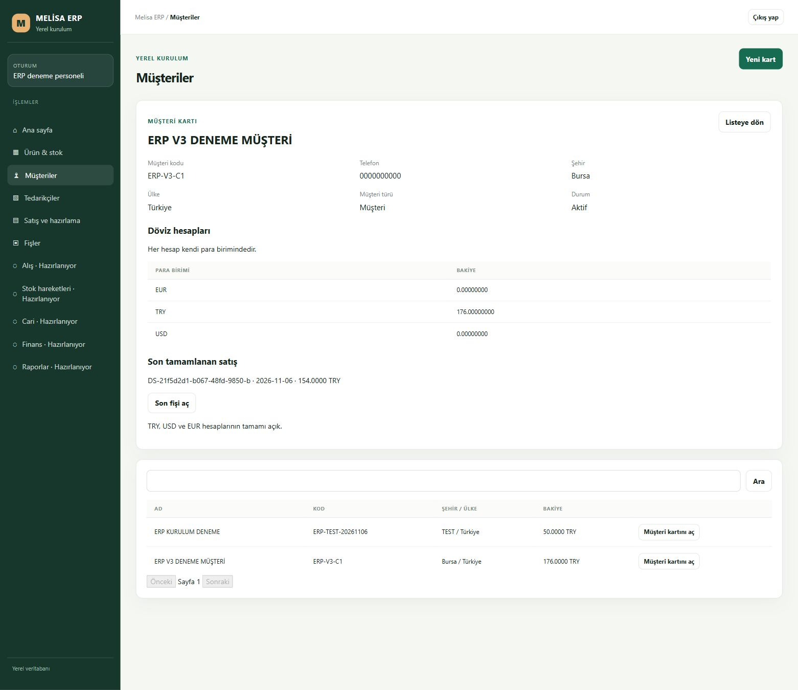

# R1 K04-03 — aynı müşterinin ayrı döviz hesapları

6 Kasım 2026; PR54 karar geçmişi korunur. Kaynak: `1469feb8ecc1ba5a478fb0328c3bbf9960dfb1f2`, dal `codex/erp-desktop-r1-currency-accounts-v4-20261106`. Bu kaynak ve kurulu teknik TEST kanıtıdır; insan, terminal, LAN ve LIVE kabulü değildir.

## Kullanıcıya görünen sonuç

Normal yeşil ERP müşteri kartında eksik TRY/USD/EUR hesabı sıfır bakiyeyle açılabilir. Her hesabın bakiyesi kendi para biriminde gösterilir; ortak döviz toplamı veya otomatik kur dönüşümü yoktur. Bir döviz hesabı zaten açıksa yeniden seçim sunulmaz. İşlem belirsiz kalırsa özgün müşteri, döviz, UUID ve gövde saklanır; başka müşteri kartından kurtarma özgün gövdeyi değiştirmez. Yeni istek ancak doğrulanmış kalıcı sonuç sonrasında mümkündür.

V3 arayüzü bu yeteneği sunmaz: normal oturumdaki kurulum kimliği V4/şema4 olarak doğrulanmadan hesap controller'ı oluşturulmaz. Geç yanıt yeni müşteri formunu silemez; kart/form ve liste isteklerinin nesil kontrolleri ayrıdır. Salt okunur incelemede bulunan bu geçiş yarışları düzeltildi.

## Şema ve kurulum

Sabit hedef `Semih\MELISAERP / MELISA_ERP_DESKTOP_TEST_20261105`, database id5/GUID `c67f5317-9c0d-4831-aadd-fadc379a95d1`, environment `eb2888c2-51cb-4570-a933-397cf7e62806`. 36 tablo aynı kalır. V3→V4 yalnız müşteri/döviz benzersizlik indeksi, mevcut journal'ın `customer.account.create` işlem kısıtı ve profil sürüm kısıtı/işareti değişikliğidir. Yeni tablo, principal, parola, rol veya GRANT yoktur.

İndeks: `UNIQUE(customer_id,currency_code) WHERE customer_id IS NOT NULL AND supplier_id IS NULL`. Çalışma guard'ı indeksin gerçek sıralı iki anahtar sütununu, yönlerini ve tam filtresini de doğrular. Journal mevcut üç işlemi korur; eski V2/V3 ifadeleri ve eski istek gövde hash'leri değişmedi.

Yeni uygulamanın tam V3 PID/komut/paket kimliği doğrulanarak yalnız uygulama durduruldu. 200 sabit kaynak/yardımcı/asset doğrulanıp ayrı yerel dizinde korundu; V3 manifesti korunur. V4'ün ayrı `master-v4-package.json` ve admission dizini vardır. SQL servisi durdurulmadı/yeniden başlatılmadı. Eski kurulum, Vega, ticari veriler ve yedekler bu işlem kapsamında değiştirilmedi.

İlk gerçek DDL denemesi tek işlemde geri alındı. Ayrı süreç/bağlantıyla şema3, metadata `386cff07…`, security `ba16496c…`, 33 tablo içerik SHA `c1ace2f5…` birebir geri geldi. Kimlik tüketen iş kaydı/audit INSERT'i bu şema denemesinde yoktur. Sonraki gerçek uygulamanın bağımsız gözleminde şema4 ve metadata `b251814b…` doğrulandı; security ve bütün iş satırları aynı kaldı. Belirsiz denemeye otomatik tekrar yapılmaz. Kanıtlar `installed-r1` altındadır.

Kurulu paket: `487b3db09e9b7264ede825fae4ac839c9c0b7db03f9628429550d16aaebf72da`, 199 kaynak / 5 yardımcı / 3 asset. Normal oturum kimliği API'si bu gerçek manifest byte hash'ini ve şema4'ü döndürdü. TLS CA/SEMIH adı ve sabit sertifika korunur; writer'ın gerçek TLS denemesinde önce/sonra veriler ve yetkiler değişmedi. Yalnız `127.0.0.1:5294 / 4294`; SQL `127.0.0.1:51433`.

## Gerçek normal ekran / API / SQL

- Ajan normal `erp_deneme` GUI'sinde müşteri3/party4 için USD hesap5 ve EUR hesap6 açtı. İkisi de `0.00000000`; eski TRY hesap4 `176.00000000` ve son tamamlanan fiş8/154 TRY korundu. Yenilemede aynı üç hesap görüldü. Diğer müşteri2'nin eski TRY hesabı50 doğru gösterildi.
- 17 gerçek normal HTTP kontrolü: manifest/SQL hedef eşliği, bağımsız SQL ile iki kart eşliği, özgün USD isteğinin aynı hesabı döndüren tekrarı, aynı UUID altında değişen müşteri/döviz reddi, normal oturum/origin/query/unsupported currency sınırları, üç hesaplı müşterinin TRY satış önizlemesi, önceki kesin fişin okunması, eşzamanlı iki farklı UUID, iki sonucun ayrı tekrarı ve müşteri izolasyonu.
- Eşzamanlı istekler müşteri2/party2 için eksik USD hesabını hedefledi: biri hesap7'yi sıfır bakiyeyle açtı, diğeri kalıcı `NOT_COMMITTED / CUSTOMER_ACCOUNT_EXISTS` journal sonucu aldı. Aynı gövdelerin tekrarları sırasıyla `200 COMMITTED replayed:true` ve `409 NOT_COMMITTED replayed:true`; ikinci hesap/audit oluşmadı.
- Toplam yalnız 3 yeni sıfır hesap, 3 hesap audit'i ve 4 journal satırı oluştu. Bu üç tablo dışındaki **30 tablonun** PK sıralı içerik hash'i birebir aynı. Bütün eski hesaplar, müşteri alanları/ana dövizleri/bakiyeleri, stok, maliyet, satışlar, hareketler, rezervler ve eski journal kayıtları aynı. Yinelenen müşteri/döviz grubu0. Şema metadata ve güvenlik hash'i kurulum sonrası değerlerle aynı.
- Nihai 33 tablo içerik SHA: `4d8c8dde0d2610cb9f60829e049e5cf4bb9feaab91a69212a348c0b940faa3fd`. Yeni sentetik hesap/journal/audit satırları nedeniyle başlangıç hash'inden farklıdır; bu değişiklik yukarıdaki tam satır sayılarıyla açıklanır.

79 ilgili çevrimdışı test dosyası, yeşil ekran derlemesi, staged secret scan ve bağımsız salt okunur kaynak incelemesi geçti. Yeni head'in GitHub CI sonucu PR kontrollerinde ayrıca izlenir; önceki PR74 ve PR75'in kendi exact head kontrolleri Windows dahil başarılıdır.

## Sınır ve devam

Hesap açma çok dövizli satış desteği değildir. Kurulu satış hâlâ TRY ile sınırlı; limit/vade, kredi onayı, fiyat/döviz koşulları, kesin satış iptali ve kalan ERP/terminal işleri açık. Gerçek ağ ACK kaybı veya değişmiş müşteri adıyla kurtarma bu kurulu denemede üretilmedi; belirsizlik/commit kaybı kaynak testleri normal SQL/GUI kanıtı yerine geçmez. Yeni normal personel/insan kabulü **BEKLİYOR**. Nihai boş işletme teslimi yapılmadı; mevcut veritabanı sentetik doğrulama kayıtlarını içerir. Merkez plan ve Excel sayaçları bu kaynak işi tarafından değiştirilmedi.
