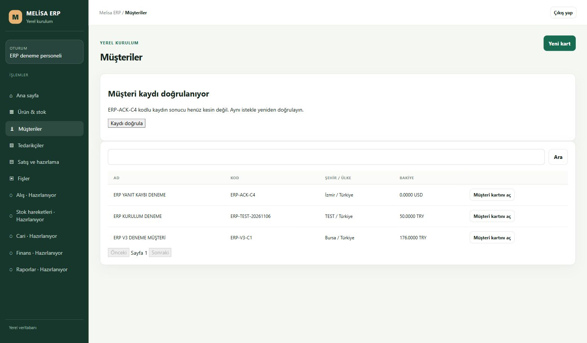
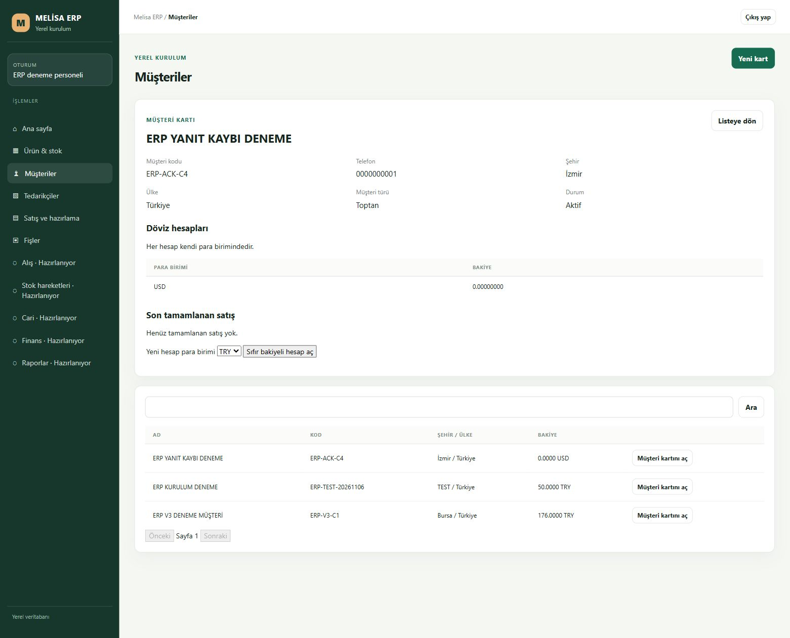

# R1 K04-01 — gerçek yanıt kaybından müşteri kaydına dönüş

6 Kasım 2026. Kaynak `406992f6a573fb6bc16f0c005b8b1d97bcf5248a`, dal `codex/erp-desktop-r1-customer-recovery-20261106`; paket `2061854ea04f00055eae48ebc566c59d2bd3e1a276b60930618b00a10a462cb2`. PR76/V4 hesap akışının devamıdır. Bu teknik normal GUI/SQL kanıtı insan, LAN, fiziksel terminal veya LIVE kabulü değildir.

## Bulunan sorun ve düzeltme

Sunucuda tamamlanan müşteri kaydının cevabı bağlantıda kaybolduğunda istemci özgün isteği doğru saklıyordu. Ancak bekleyen işlem görünümünün çıkış koruması sayfa yenilemesini de engelliyordu. Kurtarma görünümü, doğrulanmış kalıcı isteği silmeden normal gezinme/yenileme/çıkışa izin verir. Gönderilmemiş dirty alanlar, sürmekte olan gönderim ve okunamayan kalıcı veri korunmaya devam eder.

Başka sekmenin bekleyen isteği, bu sekmedeki gönderilmemiş alanların sahibi sayılmaz. Submit öncesi böyle bir istek varsa form korunur ve yeni gönderim/UUID oluşmaz. Ön kontrol ile depolama kilidi arasındaki yarışta başarısız create de alanları silmez. Açık “Bilgileri sil ve kapat” yalnız görünür gönderilmemiş formu kapatır; diğer bekleyen kaydı silmez. Gerçek durable controller + ortak storage ile her iki geliş zamanı test edildi. Salt okunur kaynak review bulgusu bu düzeltmeyle kapandı.

## Gerçek deneme

Sabit hedef `Semih\MELISAERP / MELISA_ERP_DESKTOP_TEST_20261105`, şema4. Normal `erp_deneme` GUI'sinde yalnız sentetik `ERP-ACK-C4 / ERP YANIT KAYBI DENEME`, telefon `0000000001`, İzmir/Türkiye, Toptan, USD girildi.

İlk denemede yalnız CORS OPTIONS204 ön kontrolü bekledi ve istemci zaman aşımına girdi. Bağımsız gözlem bütün 33 tabloyu, metadata ve güvenliği başlangıçla birebir aynı buldu; bu aşama kayıt tamamlanmış yanıt kaybı sayılmadı. Yeni istek veya UUID açılmadı; bekleyen özgün kayıt korundu.

Sonraki normal “Kaydı doğrula” isteğinde aynı bekleyen kayıt gönderildi. Tarayıcı geliştirici denetimi yalnız tam `/api/desktop-local/customers` Fetch **yanıt aşamasına** bağlandı; OPTIONS204 hemen geçirildi, gerçek POST201 yanıtı `ConnectionReset` ile istemciye teslim edilmeden kesildi. İstek/auth header'ları okunmadı. Geçici denetim her aşama sonunda boş pattern ile temizlendi.

Sunucu tamamlamışken ekranda sonuç belirsiz kaldı. Bağımsız SQL yeni müşteri4 / party5 / USD hesap8 / audit39 ve journal UUID `8809b55e-1c5e-4f77-b083-3493321536de` değerlerini **istemci henüz beklerken** okudu. Şehir/ülke/tür/telefon ve sıfır USD bakiyesi tam eşleşti. Başlangıca göre customers, party_entities, party_currency_accounts, audit_logs ve desktop_local_master_requests tablolarında yalnız birer satır oluştu; diğer 28 tablonun PK sıralı içerik hash'i aynı kaldı.

Ekran düzeltmesi kurulurken API/shared/scripts/5 yardımcı/bağımlılık ve şema pinleri önceki 487b paketle birebir aynı kaldı; yalnız HTML/JS ekran paketi değişti. Yalnız tam kimliği doğrulanmış yerel uygulama durdu/yeniden açıldı. Yeni paket gerçek TLS ve bağımsız SQL readmission kontrolünden geçti; SQL servisi, kullanıcı/parola/rol/yetki ve şema değişmedi. Bekleyen özgün müşteri isteği yeniden girişten sonra geri açıldı.

Yeni ekranda gerçek sayfa yenilemesi tamamlandı; normal oturumdan Müşteriler → Yeni kart yine aynı bekleyen `ERP-ACK-C4` kaydını açtı. Ajan normal “Kaydı doğrula”ya bastı. Gözlenen POST **200** yanıtının UUID'si ve gövdesi özgün kalıcı istekle eşleşti. Ekran belirsiz durumu kapatıp tek müşteri kaydını açtı; USD hesabı8 sıfır, şehir İzmir, ülke Türkiye ve tür Toptan doğru kaldı. İkinci müşteri/party/hesap/journal/audit oluşmadı.

Commit sonrası ile son yenileme/tekrar sonrası **33 tablonun bütün içerik hash'leri, metadata, security, eski müşteriler ve hesaplar birebir aynı**. Son iş satırları SHA `fe23c8b9aa8797656a40f9dfb8a26ae277ac367229659390ba8ce08a827b539b`, metadata `b251814b…`, security `ba16496c…`. Ayrıntı: [bağımsız karşılaştırma](installed-r1/r1-customer-recovery-verification.json).

Dört ilgili dosyada 33 çevrimdışı test, derleme, staged secret scan ve bağımsız readonly kaynak review geçti. Yeni exact hosted CI ayrıca izlenir. Önceki PR76'nın devam eden CI'si iptal edilmedi/değiştirilmedi.

## Sınır

Bu kontrollü gerçek tarayıcı yanıt kaybıdır; fiziksel modem veya cihaz kopması denemesi değildir. Henüz teslimin bütün R1/LAN/terminal/insan kabulü yoktur. Çok dövizli satış, limit/vade/onay ve diğer modüller açık. Deneme müşterisi sentetik TEST kaydı olarak kalır; nihai boş işletme teslimi yapılmadı. Merkez Excel/plan ve özgün kabul sayaçları bu kaynak işi tarafından değiştirilmedi.
