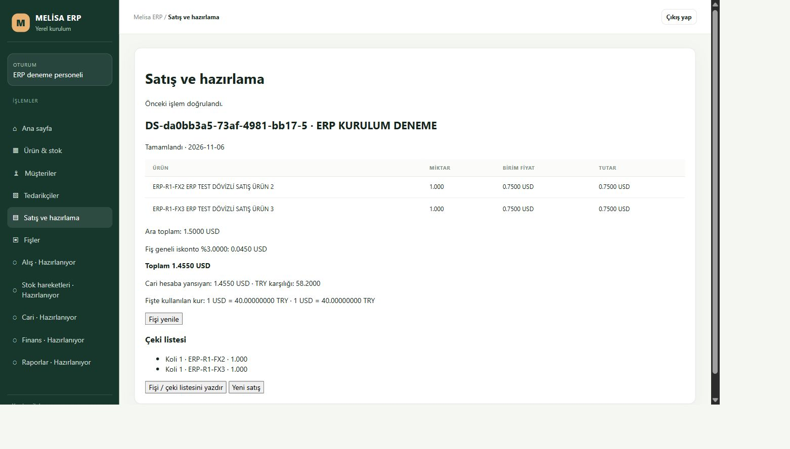
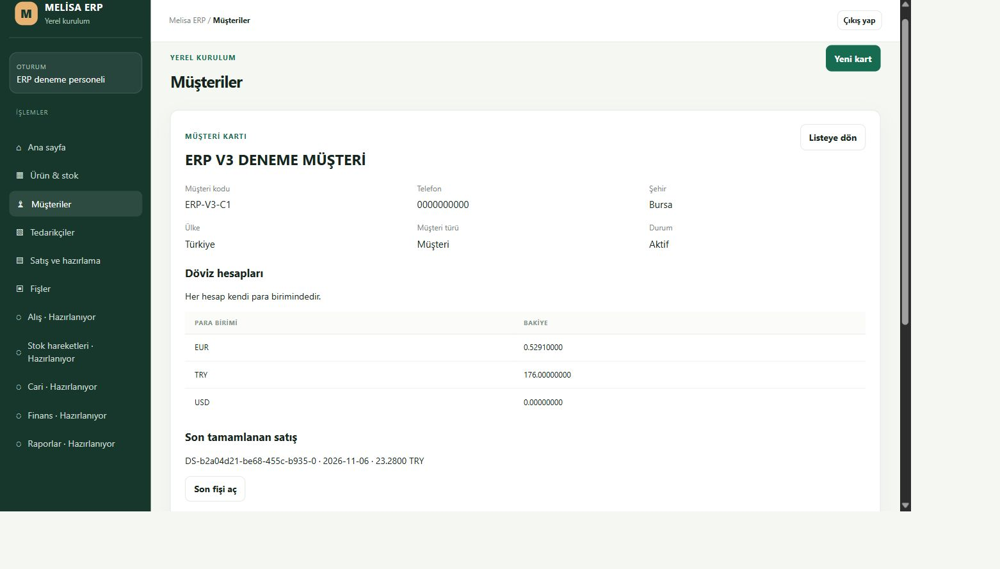

# R1 dövizli satış — kaynak hazırlığı

PR54 satış/hazırlama/koli/son kontrol zinciri korunur. Seçili TRY/USD/EUR fiyatı, seçili müşteri hesabı ve iki açık işlem kuru aynı transactionda kilitlenir. Şirketin exact tarihli önerisi ile kullanıcı işlem kuru ayrı izlenir; eksik öneri için kur1 uydurulmaz. Şirket önerisi önizleme sonrasında değişirse yeni önizleme gerekir. Kaydedilmiş fiş yeniden fiyatlanmaz.

Dövizli taslak ve sevk aynı native invoice servisini, journal/UUID ve transaction kanıtını kullanır. Ayrı USD/EUR hesabına satış müşterinin eski TRY ana bakiyesini değiştirmez. Taslağı açan ve sevk eden farklı yetkili kullanıcılar olabilir. Cari hareketi sevki yapan kullanıcıyı taşır. Stok maliyeti sevk anındaki kilitli pozitif TRY maliyetidir; bilinmeyen/sıfır maliyetle kâr uydurulmaz. Aktörün mevcut %3 tavanı korunur; yöneticinin %5/onay akışı bu işte açılmaz.

46 dosyada 228 offline test ve guardlı yeşil ekran derlemesi geçti. Native test, gerçek create/finalize JS çağrılarıyla dört hesap türü × sıfır/%3 iskonto, sonradan değişen şirket kuru/maliyet, farklı aktör, sekiz bozuk readback, izin kaybı, transaction rollback ve commit ACK kaybı/aynı istek tekrarını sınar. SQL sürücüsü sentetiktir; T-SQL ve normal ekran/SQL kurulumu yerine geçmez. B6 seçilmiş kaynak fonksiyon gövdesi ve SQL byte hash'i değişmedi; bütün native dosya pini yeni kontrollü bağ için yenilendi. B6 SQL çalıştırılmadı.

Kurulumda yalnız masaüstü yeni TEST uygulaması değişir; SQL servisi/şema/rol/izin/parola/Vega/eski ERP değişmez. Normal ekranda iki yeni sentetik ürün, 10 ADET stok ve 8 TRY maliyetle TRY12/USD0,75/EUR0,60 fiyatlarıyla oluşturulacak. Müşteri2 USD hesap7'ye birer adet USD satış %3 iskonto, 40 TRY/USD işlem kuruyla 1,455 USD /58,20 TRY olmalıdır. İki stok 9'a iner; seçili USD hesap1,455 artar; eski TRY104,32 aynı kalır. Şirket kur tablosu boş olduğu için bu kurulu deneme açık kullanıcı kuru kullanır; dolu şirket kuru gerçek SQL kanıtı sayılmaz. Yenileme/fiş/stok/cari/aynıUUID ve değişen gövde retleri bağımsız SQL gözlemiyle karşılaştırılır.

Kurulu kabul bu kaynak kaydında henüz BEKLİYOR; insan, LAN, terminal, LIVE ve tüm ERP kabulü açık. Devam eden isteklerin gerçek reload kabulü ayrıca kanıtlanır. Önceki fiş10/11 ve tüm eski satırlar korunur.

## Kurulu sonuç

Kaynak `0288010b1ed1ba211bcfd607aa983930e8e05924`, paket `8b97a133ac4dda19bf611eadbb6b72bd1f0e294bf4cf4d127c76b089288b614a`:212kaynak/5yardımcı/3asset. Yalnız5294/4294, owner38936/worker56688.49dosya252test/build/secrets ve son readonlyreview geçti. İlk geniş CI'da üç eski native VM fixture yeni getter'ı tanımadığı için kırıldı; yalnız non-desktop null binding eklendi, mevcut bütün assertions korundu. Kurulu denemede kalıcı pending'e rağmen gereksiz kapanış engeli çıktı; geçerli kayıt için yeniden açılma düzeltildi, bozuk storage/busy/kaydedilmemiş koli engeli korundu. Exact uygulama kaynağının hosted kalite/secrets PASS; Windows sonucuna PR kaydından bakılır.

| Fiş | Belge | Seçili hesap etkisi | TRY karşılığı | TRY kâr |
|---|---|---|---|---|
|12|1,4550USD|müşteri2/USD7 +1,4550USD|58,2000|42,2000|
|13|1,1640EUR|müşteri2/USD7 +1,2804USD|51,2160|35,2160|
|14|23,2800TRY|müşteri3/EUR6 +0,5291EUR|23,2800|7,2800|

Üç fiş %3iskonto ile normal taslak→hazırlama→koli→hazır→kontrol→çıkıştan geçti. Ürün10/11:10→9→8→7ADET. Son USD7=2,73540000/EUR6=0,52910000; müşterilerin TRY104,32/176ana bakiyeleri ve diğer hesaplar aynı. Toplam6stokçıkışı/3carihareketi/18workflowjournal. Kur kaynağı audit'te işlem override olarak saklandı; TRY1system. Dolu şirket kuru SQL kanıtı yok; kur tablosu0satır.

Fiş12 POST201 response aşamasında yakalandı, istemciUNKNOWN kaldı. Yanıt uzun beklerken interception süresi dolduğu için sonraki manuel failRequest kabul edilmedi; ConnectionReset komutunu başarılı saymıyoruz. Bağımsız SQL zatenCOMPLETED okudu. Yeni normal giriş, gerçekDocument200yenilemesi ve aynı UUID/tamgövdeyle1POST200 istek kurtarıldı. EURkoli kaydı da belirsiz kaldığında normal yeni girişten sonra aynı istek bir kez tamamlandı. Oturum sonundaki aynı sayfa uyarısı halen genelUNKNOWN; kolay yeniden giriş görünümü sonraki kullanıcı deneyimi eksiklerindendir.

27normalHTTP kontrolü: üç fişin doğru kur/hesap/stok okuması, exact replay ve aynıUUIDdeğişen kur/hesap/mode/tarih retleri. Tekrar sonrası33tablo/metadata/identity bütünü aynı. Eski33tablonun başlangıç satırları ayrı readonly SQL'de yeni satırlar dışlanarak, yalnız yetkili hesap6/7bakiye etkisi okumada başlangıç değerine projekte edilerek hash bazında birebir doğrulandı; gerçek veriye ters UPDATE yapılmadı. Şema/securityhash aynı, SQLservis/GRANT/hesap/parola/Vega/eskiERP değişmedi.

[İlk USD bağımsız kanıtı](installed-proof.json), [üç para birimi kanıtı](cross-installed-proof.json). Normal ekran screenshotları aşağıda; ajan GUI/görsel doğrulamasıdır. İnsan/LAN/terminal/LIVE ve tümERP kabulü BEKLİYOR. A4fiş12PDF: Masaüstü/ERP/output/pdf/dovizli-satis-12.pdf,1sayfa render/görselPASS; fiziksel yazıcı denenmedi. TEST sentetik kayıtlar içerir, nihai boş işletme teslimi değildir.

