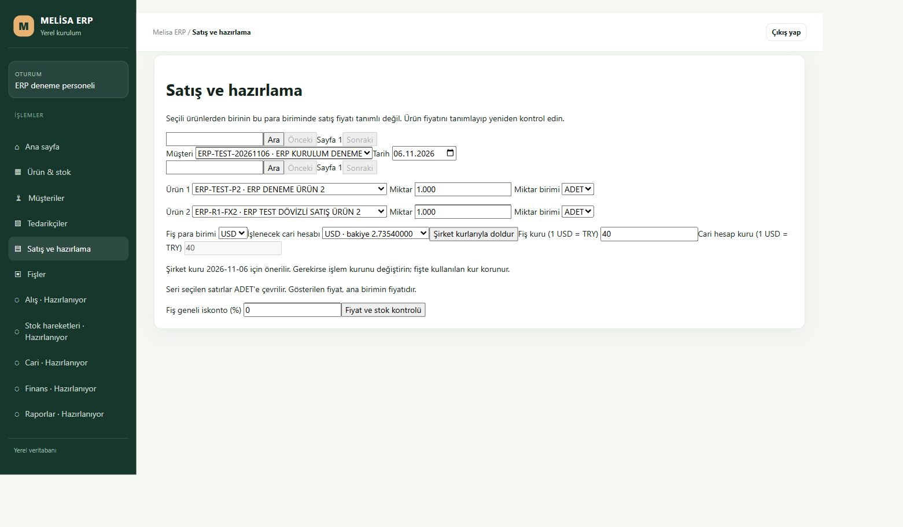

# K03-04 — eksik döviz fiyatı uyarısı

İlk satışta mevcutürün2 ERP-TEST-P2:4ADETsatılabilir, yalnızTRY20fiyat; müşteri2/USD7 ve USD40işlemkuruyla, mevcutürün10yanında normalönizlemede denendi. Eski paketteGET503vegeneluyarı, Taslağıkaydetdüğmesiyok;33iştablosu/metadata/identity/rezerv aynı. Fiyat0sayılmadı. Yeni ürün/satış/rezerv oluşturulmadı.

Kaynak düzeltmesi yalnız seçilen currency baseprice gerçekten bulunmuyorsa normal yetkili önizlemeye sonlu409DESKTOP_SALE_PRICE_REQUIRED ve açık Türkçe uyarı verir. Aynı fiziksel hedef/normalaktör/heldtransaction/scope ve aktif customer-account-parent kontrolleri korunur. Aktif ürünün tek ana birimi/factor1, primarybarcode ilişkisi sağlam olmalıdır. Fiyat var ama linki/kesinliği bozuksa bu uyarı verilmez; genel ret sürer. Eksik/bozuk fiyat0veyaTRYkuru/fiyatı ile tamamlanmaz. Yazma kapısı açılmaz.

49dosya253hedefli test, guardlı yeşil ekran build, readonlyreviewPASS. Nativeinvoice/B6pini/SQLDDL/GRANT/parola değişmedi. Kurulum ve yeni409normalGUI/bağımsızSQLkabulü sırada; sourcePASS insan kabulü değildir.

K04-06 ayrıntılı hesap geçmişi ikinci teslimdir. KaynakWIP5430704a, codex/erp-desktop-r1-account-sales-history-20261106 dalında korunur ve bu düzeltmeye/kurulu pakete alınmaz. Sonraki ilk satış kontrolü K05-02 iki farklı ürün + aynı barkod tekrarının doğru miktar/toplamı; eski geçerli satışlar tekrarlanmaz, yeni test ürünleri açılmaz.

## Kurulu kabul

Kaynak00fa0834b65ce9d87a0d8d7d182d8085c753d981, paket3a972bb8bb79bfe20e8d6328864b67c0c74d9d4c40484cc1dda729cb2a848899;212kaynak/5yardımcı/3asset. Owner24092/worker19632, yalnız5294/4294. Normal erp_deneme girişinden müşteri2/USD7, mevcutürün2+10 ve USD40işlemkuruyla aynıönizlemeGET409verdi. Ekran “Seçili ürünlerden birinin bu para biriminde satış fiyatı tanımlı değil. Ürün fiyatını tanımlayıp yeniden kontrol edin.” gösterdi; Taslağıkaydetdüğmesiyok, satışPOST0. Hiçbirfiyat0olaraktüretilmedi.

Kurulum öncesi/sonrası ve normalGUIsonrası bütün33iştablosu, metadata, security, identity, stok/rezerv/cari/fiş/journal aynı. Ürün2 fiziksel4/rezerve0/satılabilir4, yalnızTRY20fiyat; businessSHA21ce02fd066cbbc4d4ae76471fdde7b3d35c8b429249d615bc4f6a2880ebeb4b. Gerçek API importgraphında yalnız route ve FXselector hash'i değişti; nativeinvoice/B6/SQLsnapshot/helper/dependency aynı. Logger finitecode CI kaynağıdır, bu runtimegraphına dahil değil. HTML/JS yenilendi, CSSaynı. Şema/GRANT/SQLservis/parola/Vega/eskiERP değişmedi, R2hesapgeçmişimodülüpaketteyok.

[Bağımsız kurulu kanıt](installed-proof.json). Ajan normalGUI/görsel/SQL PASS; insan/LAN/terminal/LIVE ve tümERP kabulü açık. Yeni ürün veya satış açılmadı; önceki geçerli satışlar tekrarlanmadı. Kaynak253test/build/review/secretsPASS; yeni exactCI ayrıca izlenir.

